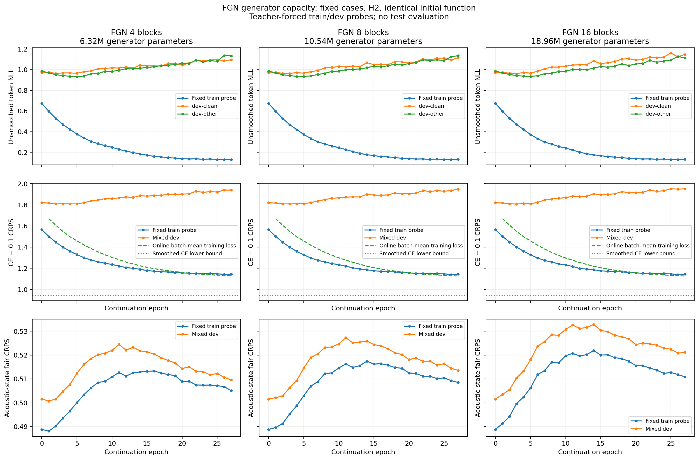

# Double-descent review — 2026-11-13

The current experiments do **not** establish that double descent is absent. They show worsening token validation risk through continuation epoch 27 under one fixed-case, warm-started recipe. The original epoch-11 stop located an operational overfit pattern; it was not designed to test later recovery. The epoch-27 extension only expands the observed window.

## Primary research and interpretation

[Belkin et al.](https://arxiv.org/abs/1812.11118) study risk beyond interpolation. [Nakkiran et al.](https://arxiv.org/abs/1912.02292) report model-wise and epoch-wise double descent across deep-learning settings. The latter includes label-smoothed Transformer experiments. These observations do not guarantee recovery in every task or give a universal required epoch count. Generator noise and corrupted training labels are different interventions.

## Reanalysis of existing curves

No new training, checkpoint selection or test evaluation was performed. The audit reads the saved aggregate CSV, with 28 points per model: epochs 0–11 from the original capacity experiment and 12–27 from the extension. Epoch 0 already represents a trained model, not random initialization.

| FGN blocks | Best dev NLL, epoch 5 | Dev NLL, epoch 27 | Dev CRPS peak, epoch | Dev CRPS, epoch 27 |
|---|---:|---:|---:|---:|
| 4 | 0.9486 | 1.1147 | 0.52447, 11 | 0.50961 |
| 8 | 0.9509 | 1.1269 | 0.52730, 11 | 0.51360 |
| 16 | 0.9504 | 1.1306 | 0.53285, 14 | 0.52117 |

Descriptive linear slopes over epochs 12–27 are positive for dev token NLL and the optimized dev objective in every model. They are negative for dev state CRPS in every model. There is no sustained second decline in token risk over the measured late window. There **is** late recovery in the state component. The latter is worth investigating, but does not establish an interpolation-driven mechanism: the joint objective can trade token and state losses against each other. Slopes have no attached significance test.

The final CRPS remains above the early minimum, but beating the first minimum is **not a necessary definition** of a second descent. We therefore do not use that comparison to reject double descent. Three sparse depth settings also cannot establish the shape of a model-size risk curve.



## What remains untested

- **Epoch-wise:** risk beyond epoch 27. A predetermined extension such as epoch 96 would test a longer finite window, not prove eventual presence or absence. Keep the optimizer/LR policy declared; an LR-change condition should be identified separately. Do not stop just because dev risk rises.
- **Model-wise:** a sufficiently broad size sweep around the empirically located fitting transition. The three existing models change depth only, keep hidden/memory sizes at 256 and share a trained initial function. A width sweep and independent initializations would answer a different question and must be controlled explicitly.
- **Interpolation:** hard prediction error and margins on the full fixed training set. The 512-case probe's 98.44% accuracy does not locate a whole-dataset interpolation threshold. Smoothed CE need not reach zero, and a raw parameter-to-example ratio does not locate that threshold either.
- **Replication:** multiple seeds, fixed evaluation roles and separately reported token risk, hard accuracy, state CRPS and joint objective. Do not pool these metrics into one double-descent claim.

These are proposed follow-ups, **not completed or running experiments**. No new AR-only/no-noise control or ASR WER result is implied. The supported conclusion remains: depth growth and more epochs did not improve the measured token validation risk within this study's observed range; later recovery and other scaling regimes remain open.

## Reproduce this descriptive audit

```bash
.venv/bin/python experiments/fgn_capacity_long_v1/audit_double_descent.py
```

[Numeric audit](../experiments/fgn_capacity_long_v1/artifacts/double_descent_audit.json) · [Completed epoch extension](fgn_capacity_long_2026-11-13.md) · [Current conclusions](conclusion_and_next_steps.md)
