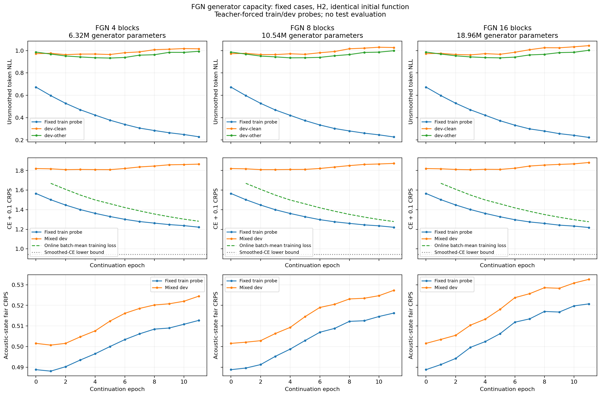

# FGN generator capacity and overfitting — 2026-11-12

3 of 3 capacities met the declared overfit rule. At the common epoch 11, moving from 4 to 16 generator blocks changes train-probe NLL from 0.22883 to 0.22281 and dev NLL from 1.00425 to 1.02281. The original 6.32M generator can already overfit this fixed-case task; increasing capacity is not a prerequisite for observing that pattern.

Completed the user-requested capacity diagnosis on the existing AR+FGN hybrid. This enlarges the generator itself, not AR depth. The raw-audio corrector and encoder-skipping system remain unimplemented.

Training ran for 1.04 hours from runner start through its completed stage, excluding prior cached-feature preparation and benchmarks. Total completed continuation epochs: 33. No test evaluation or test-driven checkpoint selection.

## Best and final checkpoints

| FGN blocks | Generator parameters | Epochs completed | Best dev epoch | Best dev NLL | Last train-probe NLL | Last dev NLL | Overfit rule met |
|---|---:|---:|---:|---:|---:|---:|---|
| 4 | 6,323,968 | 11 | 5 | 0.9486 | 0.2288 | 1.0042 | Yes |
| 8 | 10,535,680 | 11 | 5 | 0.9509 | 0.2269 | 1.0127 | Yes |
| 16 | 18,959,104 | 11 | 5 | 0.9504 | 0.2228 | 1.0228 | Yes |

All capacities completed 11 continuation epochs. Their last-checkpoint columns therefore share an epoch budget, although parameter count and wall-clock/compute cost differ.

## Matched comparison at epoch 11

| FGN blocks | Train-probe NLL | Dev NLL | Train-probe objective | Dev objective |
|---|---:|---:|---:|---:|
| 4 | 0.2288 | 1.0042 | 1.2214 | 1.8652 |
| 8 | 0.2269 | 1.0127 | 1.2203 | 1.8725 |
| 16 | 0.2228 | 1.0228 | 1.2179 | 1.8817 |

Observed capacity differences at this common budget:

- 8 versus 4 generator blocks: train-probe NLL -0.00188; dev NLL +0.00847; evaluation-mode train-probe objective -0.00106.
- 16 versus 4 generator blocks: train-probe NLL -0.00602; dev NLL +0.01856; evaluation-mode train-probe objective -0.00341.

The lowest observed selected dev NLL is 0.94858 with 4 generator blocks. This is a descriptive single-seed minimum on model-selection data, not a statistically established architecture winner.

## Acoustic-state loss

| FGN blocks | Initial train-probe CRPS | Last train-probe CRPS | Initial dev CRPS | Last dev CRPS |
|---|---:|---:|---:|---:|
| 4 | 0.48883 | 0.51272 | 0.50158 | 0.52447 |
| 8 | 0.48883 | 0.51627 | 0.50158 | 0.52730 |
| 16 | 0.48883 | 0.52073 | 0.50158 | 0.53262 |

Token likelihood and acoustic-state forecast loss must be assessed separately. The optimized weighted sum can improve while the state component worsens. A lower token NLL does not establish a more useful predicted acoustic representation for a future corrector.

## What the curves establish

- Larger nested function classes can attain an equal or lower global empirical minimum, but the finite optimizer need not realize that advantage.
- The predeclared overfit rule requires five successive held-out NLL regressions of at least 0.02 and training-probe improvements of at least 0.01 relative to the dev-optimal checkpoint, after at least eight epochs. A limit or a plateau does not count.
- The optimized objective is smoothed token CE + 0.1 state CRPS. The figures separately show unsmoothed NLL, that objective and state CRPS. Improvement in one component does not establish improvement in another.
- Online training loss is an unweighted average of training-batch objectives while weights change during the epoch. Fixed-probe objectives are measured in evaluation mode after the epoch. Their numerical difference is not a generalization gap on identical inputs.

## Task and limitations

- All 28,539 train-clean-100 utterances contribute one fixed token/cutoff case. This deliberately tests fitting a fixed problem, not every possible prefix in 100 hours. Do not directly compare absolute values with the earlier random-cutoff/curriculum curves.
- Train and model-selection dev probes each have 512 cases. Reference prefixes are teacher-forced; these NLLs are not final ASR WER or recognized-prefix acceptance.
- AR remains four layers and is jointly trainable. Only generator depth changes: hidden size, memory size, noise dimension, data and optimization settings are held fixed. This is not a study of every possible width/capacity scaling strategy.
- Every model starts from the same trained function through identity initialization of added residual blocks. Best and last checkpoints are preserved separately.
- Label smoothing 0.1 over 500 classes gives a CE lower bound of approximately 0.94466 nats. Zero optimized loss is not an appropriate target. Separately, identical no-audio prefixes have conflicting labels; see the input-ambiguity diagnostic.
- One seed, development-based stopping and a fixed-case task limit generalization claims. No independent test or final-WER claim is made.
- These results do not demonstrate efficient raw-audio correction, valid cache recovery or lower inference cost. Those remain the next architecture question.

## Verification and files

- Training sources and recorded input hashes match the pre-result capture.
- Checkpoint epochs, best-dev selection, full epoch step counts and the declared overfit events match the logs.
- Added blocks have nonzero trained output weights; initial checks establish identical logits and nonzero gradients.
- Weights and logs remain local in `runs/fgn_capacity_v1/`. Public aggregates are in `experiments/fgn_capacity_v1/artifacts/`.

[Protocol and commands](../experiments/fgn_capacity_v1/README.md) · [Current research direction](predict_correct_acceleration_plan_2026-11-12.md) · [Experiment index](../experiments/README.md)
