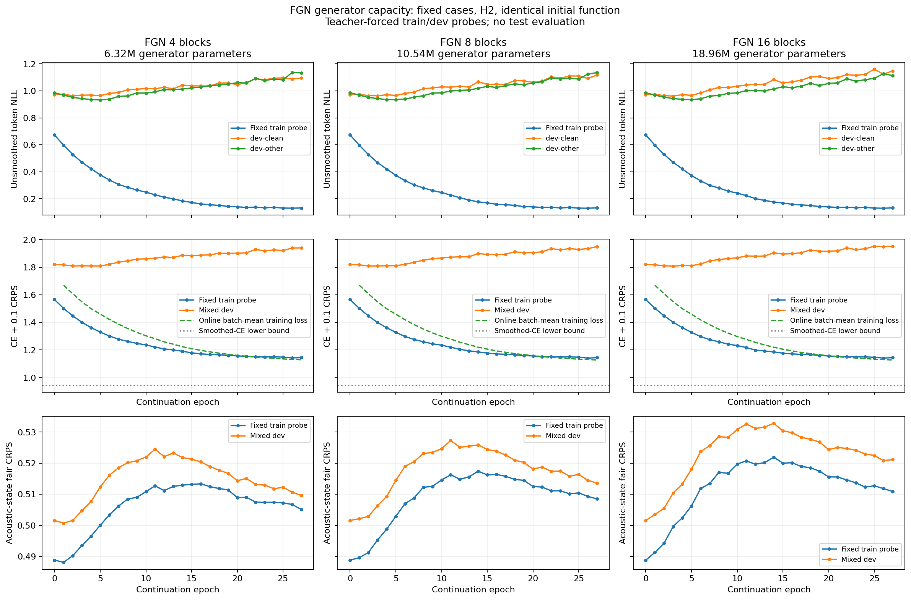

# Longer FGN training — 2026-11-13

From epoch 11 to 27, train-probe NLL improved in 3/3 models, dev NLL improved in 0/3, and dev acoustic-state CRPS improved in 3/3. 0/3 models selected a new best-dev-NLL checkpoint during the extension.

Observed final train-probe NLLs span 0.1313–0.1322 across a threefold generator-size range. Additional epochs improve fitting, while validation token likelihood and accuracy worsen in these runs. The small generator already reaches similar fitting values; this is not statistical equivalence or a test of wider generators, larger memory or the full distribution of temporal cutoffs.

Completed 16 additional epochs per model, extending the prior capacity experiment from epoch 11 to 27. All three models restored their exact saved model and AdamW states. Overfit observations were recorded without stopping. Original experiments and best checkpoints remain unchanged.

Sequential extension runner time: 1.75 hours. This excludes the earlier 33 training epochs and prior feature/checkpoint preparation. No test evaluation or final-WER claim.

## Before and after the extra epochs

| Generator parameters | Train-probe NLL: epoch 11 → 27 | Dev NLL: epoch 11 → 27 | Best dev NLL | Best epoch |
|---|---:|---:|---:|---:|
| 6,323,968 | 0.2288 → 0.1313 | 1.0042 → 1.1147 | 0.9486 | 5 |
| 10,535,680 | 0.2269 → 0.1322 | 1.0127 → 1.1269 | 0.9509 | 5 |
| 18,959,104 | 0.2228 → 0.1319 | 1.0228 → 1.1306 | 0.9504 | 5 |

All final comparisons share the same epoch budget. Larger models use more parameters and compute; this is not a fixed-compute scaling comparison.

## Auxiliary probe accuracy

| FGN blocks | Train-probe Hit@1: epoch 11 → 27 | Dev Hit@1: epoch 11 → 27 |
|---|---:|---:|
| 4 | 96.88% → 98.44% | 79.30% → 77.93% |
| 8 | 96.88% → 98.44% | 78.71% → 76.95% |
| 16 | 96.88% → 98.44% | 78.32% → 77.34% |

These are teacher-forced next-token probe accuracies, not final ASR WER. NLL also depends on probability assigned to the target, so a change in NLL is not the same quantity as a change in token accuracy. Checkpoint selection remains fixed to dev NLL.

## Acoustic-state prediction

| FGN blocks | Train-probe CRPS: epoch 0 → 11 → 27 | Dev CRPS: epoch 0 → 11 → 27 |
|---|---:|---:|
| 4 | 0.48883 → 0.51272 → 0.50512 | 0.50158 → 0.52447 → 0.50961 |
| 8 | 0.48883 → 0.51627 → 0.50853 | 0.50158 → 0.52730 → 0.51360 |
| 16 | 0.48883 → 0.52073 → 0.51093 | 0.50158 → 0.53262 → 0.52117 |

Epoch 0 is the shared, already-trained function before the capacity study, not random initialization. 0/3 models have lower final dev CRPS than that function. Recovery relative to epoch 11 does not necessarily establish an improvement relative to epoch 0.

Token likelihood, state CRPS and optimized loss must be read separately. The objective remains branch-mean token CE with label smoothing 0.1 + 0.1 state CRPS. A falling token NLL alone does not demonstrate better acoustic representations.

## Settings and scope

- FGN uses SiLU, with hidden dimension 256, FFN dimension 1,024, four heads and 256-dimensional GRU memory. Its output is a linear residual with no terminal ReLU.
- The generator has 4 / 8 / 16 blocks; AR remains four layers. Width and memory are fixed, so these runs do not assess width or memory scaling. Two acoustic forecast steps and two noise branches; new 32-dimensional noise at each step.
- AdamW states continue from epoch 11, learning rate 3e-5, weight decay 0.01, gradient clip 5. No activation, objective, sampling or learning-rate change accompanies the extra epochs.
- One fixed token/cutoff per each of 28,539 train-clean-100 utterances; fixed train/dev probes of 512 each. Teacher-forced prefixes and one seed limit the conclusion to this fitting diagnostic.
- These data do not establish a causal effect of functional noise, final recognition quality, useful residual correction or lower inference cost.
- No AR-only or noise-free control receives the extra epochs here. This is an epoch-extension diagnosis of the same stochastic hybrids, not a new matched-budget FGN-versus-AR comparison.

## Verification and provenance

- Restored-model train/dev NLL agrees with each saved source checkpoint within 1e-5 before updates; optimizer step counters continue from 4,521.
- All requested epochs, best-dev selection, final checkpoint metrics, global step counts and original input/source/checkpoint hashes passed verification.
- Epochs 0–11 in the figure are inherited evidence. Only epochs 12–27 are new training.
- Public aggregates and settings are in `experiments/fgn_capacity_long_v1/artifacts/`; raw weights and logs remain local-only in `runs/fgn_capacity_long_v1/`.

[Protocol](../experiments/fgn_capacity_long_v1/README.md) · [Original capacity results](fgn_capacity_2026-11-12.md)
