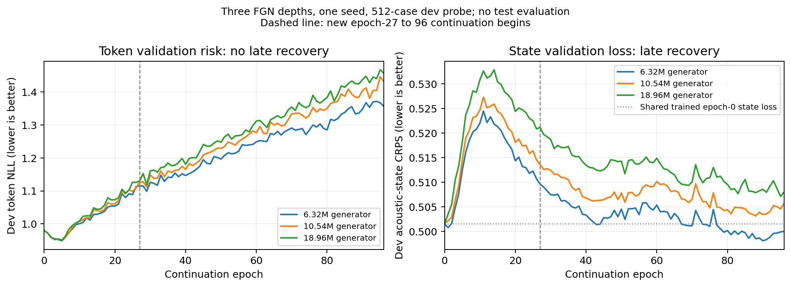
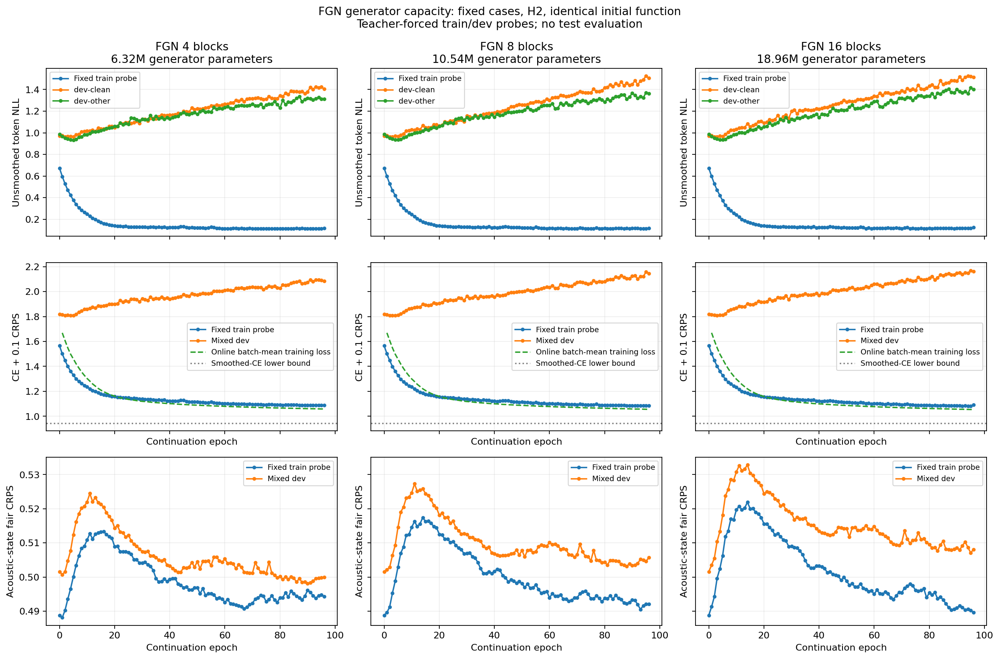
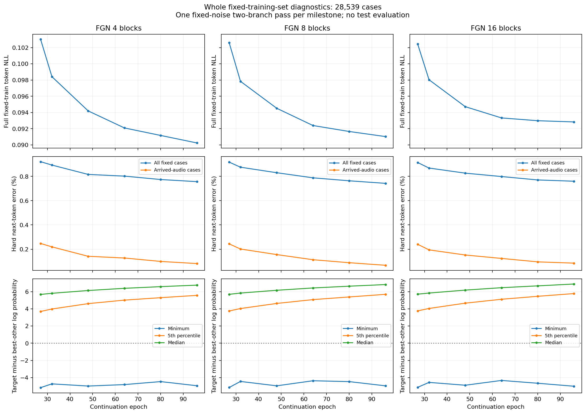

# FGN epoch-wise double-descent investigation — 2026-11-13

Final results reviewed on 2026-11-14, America/Los_Angeles. The filename retains the experiment launch date.

All three generators completed epoch 96. Token validation NLL rises across every predeclared late window for each model; no sustained second token-risk descent is observed in this horizon. State CRPS shows late recovery in every model, and the 6.32M final score is slightly below its shared trained epoch-0 score. That component-specific shape does not establish an interpolation-driven mechanism or improved held-out token prediction.

Completed 69 additional epochs for each generator, from 27 through 96, without early stopping. Sequential runner time: 7.50 hours. Original model/AdamW states were restored; the prior experiment and best checkpoints remain unchanged.

## Token risk and checkpoint selection

| FGN blocks | Generator parameters | Last train-probe NLL | Last dev NLL | Selected best dev NLL | Best epoch |
|---|---:|---:|---:|---:|---:|
| 4 | 6,323,968 | 0.11777 | 1.35715 | 0.94858 | 5 |
| 8 | 10,535,680 | 0.11635 | 1.43219 | 0.95087 | 5 |
| 16 | 18,959,104 | 0.12724 | 1.45751 | 0.95043 | 5 |

## Changes from epoch 27 to 96

| Generator parameters | Dev token NLL: 27 → 96 | Dev next-token Hit@1: 27 → 96 | Dev state CRPS: initial → peak → final |
|---|---:|---:|---:|
| 6,323,968 | 1.11472 → 1.35715 | 77.93% → 76.76% | 0.50158 → 0.52447 → 0.49998 |
| 10,535,680 | 1.12691 → 1.43219 | 76.95% → 75.59% | 0.50158 → 0.52730 → 0.50572 |
| 18,959,104 | 1.13055 → 1.45751 | 77.34% → 74.41% | 0.50158 → 0.53285 → 0.50803 |

These are reference-prefix next-token probe metrics, not ASR WER. The probes contain 512 fixed cases. Epoch 0 is an already-trained shared function, not random initialization. The small model reaches its minimum dev state CRPS of 0.49808 at epoch 90; no statistical significance is established for that small difference from the initial function. A second descent does not need to beat the first minimum.

## Declared epoch-window means

Window means are descriptive, single-seed summaries. They do not supply a significance test or identify a double-descent mechanism. A second decline need not outperform the first minimum.

| Blocks | Window | Mean dev NLL | Mean dev CRPS |
|---|---|---:|---:|
| 4 | 28–40 | 1.13345 | 0.50612 |
| 4 | 48–64 | 1.22994 | 0.50424 |
| 4 | 80–96 | 1.34220 | 0.49931 |
| 8 | 28–40 | 1.15012 | 0.51026 |
| 8 | 48–64 | 1.25919 | 0.50835 |
| 8 | 80–96 | 1.39411 | 0.50429 |
| 16 | 28–40 | 1.16924 | 0.51668 |
| 16 | 48–64 | 1.27908 | 0.51378 |
| 16 | 80–96 | 1.42482 | 0.50862 |

## Full fixed-training-set diagnostics

| Blocks | Epoch | Cases | Hard errors | Token NLL | State CRPS | Minimum log-probability margin |
|---|---:|---:|---:|---:|---:|---:|
| 4 | 27 | 28539 | 263 | 0.10302 | 0.50102 | -5.16175 |
| 4 | 32 | 28539 | 255 | 0.09842 | 0.49882 | -4.72530 |
| 4 | 48 | 28539 | 233 | 0.09420 | 0.49360 | -4.97915 |
| 4 | 64 | 28539 | 229 | 0.09210 | 0.49011 | -4.80917 |
| 4 | 80 | 28539 | 221 | 0.09117 | 0.48800 | -4.46088 |
| 4 | 96 | 28539 | 216 | 0.09025 | 0.48662 | -4.94267 |
| 8 | 27 | 28539 | 262 | 0.10262 | 0.50301 | -5.14601 |
| 8 | 32 | 28539 | 250 | 0.09784 | 0.50033 | -4.44406 |
| 8 | 48 | 28539 | 237 | 0.09452 | 0.49477 | -4.95254 |
| 8 | 64 | 28539 | 225 | 0.09240 | 0.49069 | -4.36336 |
| 8 | 80 | 28539 | 218 | 0.09166 | 0.48749 | -4.46220 |
| 8 | 96 | 28539 | 212 | 0.09103 | 0.48532 | -4.95363 |
| 16 | 27 | 28539 | 261 | 0.10244 | 0.50687 | -5.12696 |
| 16 | 32 | 28539 | 248 | 0.09804 | 0.50352 | -4.55426 |
| 16 | 48 | 28539 | 236 | 0.09472 | 0.49631 | -4.88356 |
| 16 | 64 | 28539 | 228 | 0.09333 | 0.49173 | -4.32712 |
| 16 | 80 | 28539 | 220 | 0.09299 | 0.48849 | -4.65420 |
| 16 | 96 | 28539 | 217 | 0.09284 | 0.48502 | -5.00026 |

Final arrived-audio training errors out of 28,318 cases are 23 / 19 / 24 for 4 / 8 / 16 blocks, versus 70 / 69 / 68 at epoch 27. Zero-audio errors are 193 in each final fixed-noise pass. Better training fit does not translate into better validation token risk.

All 28,539 fixed training cases are evaluated at milestones. Each measurement uses one fixed-noise two-branch pass; zero errors in one pass would not establish correctness for every noise draw. The input audit finds 221 identical complete no-audio prefixes with conflicting targets, contributing at least 193 expected hard errors under fresh independent functional noise. This expectation is not a bound on every finite pass. Arrived-audio subset errors are retained separately in the numeric evidence. A raw parameter/example ratio, a smoothed-loss floor or a 512-case probe cannot locate the interpolation threshold.

## Limits and provenance

- Epochs 0–27 are inherited evidence. Only 28–96 are new training in this namespace.
- This investigates epoch-wise behavior for three existing warm-started depths, with one seed. It is not a broad model-size/width/memory sweep or an independent replication.
- Architecture, functional noise, CE(smoothing 0.1) + 0.1 state CRPS, AdamW learning rate 3e-5, weight decay 0.01 and global epoch seeds remain fixed.
- Token NLL, hard error, state CRPS and joint objective must be interpreted separately. Recovery in one component need not improve another.
- No test evaluation, new AR-only/no-noise control, final ASR WER, raw-audio correction or compute-acceleration claim.
- Verification checks saved model/optimizer/snapshot epochs, source hashes, original-run preservation and full-training milestone counts. Finite-window findings do not prove eventual presence or absence of double descent.

[Protocol](../experiments/fgn_double_descent_v1/README.md) · [Earlier review](double_descent_review_2026-11-13.md) · [Deep Double Descent](https://arxiv.org/abs/1912.02292)
