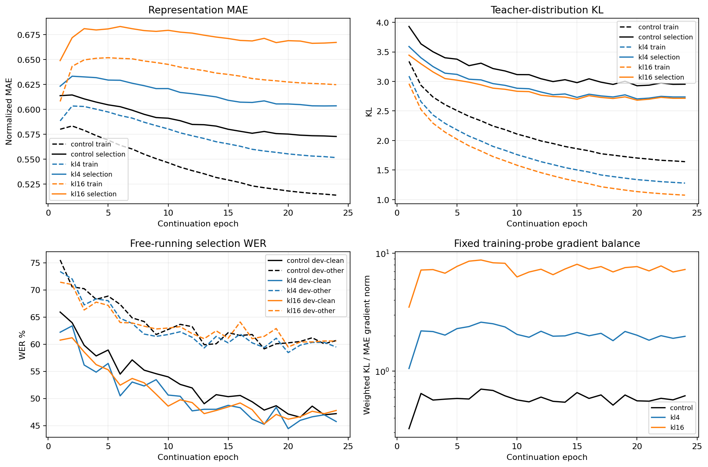

# A3 matched KL-weight comparison — 2026-11-15

Selected arm: **kl4**, chosen on the original model-selection role before final decoding. Final dev-clean WER **41.381%**; complete cost **13.18%** of the same-run teacher. The joint <10% WER / <=50% cost gate fails.

Two new 24-epoch continuations plus a disposable 100-update control replay, evaluation and verification completed in 2.75 runner hours. The original A2 24-epoch arm is reused as control. One seed; 400 dev-clean + 400 dev-other final-role utterances; no test split. Completion: 2026-11-15T17:41:27.562614-08:00.

## Final WER and complete CPU cost

| Path | Clean WER % | Other WER % | Clean ms/chunk | Other ms/chunk |
|---|---:|---:|---:|---:|
| teacher | 2.933 | 8.817 | 9.045 | 9.042 |
| small | 3.560 | 10.972 | 4.289 | 4.293 |
| control | 42.303 | 61.915 | 1.171 | 1.165 |
| kl4 | 41.381 | 61.521 | 1.192 | 1.186 |
| kl16 | 42.392 | 63.113 | 1.182 | 1.176 |

Small uses the repaired, model-specific blank-filled initial context. Full teacher and A2/A3 retain their original decoder convention. Original A2 control token sequences reproduce on all 800 utterances. Small input availability is 60ms shorter (39 versus 45 feature frames), so this is not an exactly matched-lookahead architecture comparison.

## Post-run interpretation

Increasing KL weight by 4x gives estimated WER reductions of 0.922pp on clean and 0.394pp on other, but both paired 95% intervals include zero. An improvement over the control is not established at that interval level. The 16x arm is numerically unchanged on clean and 1.197pp worse on other, whose conditional interval excludes zero. These are single-seed, fixed-checkpoint comparisons, not evidence of universal equivalence or failure.

The coefficient change does not resolve the accuracy bottleneck: the selected model still has 41.38% clean WER against the <10% gate. Its complete cost passes at 13.18% of the same-run teacher. The repaired public 20M baseline already has 3.56% clean WER at 47.79% of teacher cost, demonstrating a much stronger useful-accuracy reference. Its upstream training budget differs, so this is not an equal-training-data comparison.

Both larger coefficients lower the optimized KL but worsen representation MAE. Final-role normalized state MAE is 0.5333/0.5960 for control, 0.5670/0.6232 for 4x and 0.6332/0.6825 for 16x (clean/other). A lower component loss alone does not demonstrate a better recognizer. Loss-validation curves aggregate the selection role's clean and other utterances, while training uses clean-100 only; the train/validation KL gap does not isolate data shortage from domain, objective or architecture effects.

The 4x/16x epoch wall totals are 77.09/77.09 minutes, including validation and CPU checkpoint selection. Maximum sampled MPS driver allocation is 3.247GiB in both arms, not a continuous total-system-RAM peak. No further training, FGN/B/C continuation or 960h label expansion was started.

## Fixed training conditions and treatment

All arms start from the same A2 epoch-12 MAE checkpoint. Architecture, seed 237, sampled windows/order, 24 epochs, fresh AdamW, 3e-4 schedule, clipping, temperature 2, blank weight 0.1, two-epoch KL ramp and checkpoint rule are unchanged. Only the KL coefficient in `MAE + lambda * KL` changes. Native teacher contexts supervise the loss; inference is free-running and sees no teacher encoder state or reference transcript.

| Arm | KL multiplier | Final coefficient | Selected epoch | Selection clean WER % |
|---|---:|---:|---:|---:|
| control | 1 | 0.02600918 | 21 | 46.540 |
| kl4 | 4 | 0.10403670 | 20 | 44.428 |
| kl16 | 16 | 0.41614681 | 18 | 45.302 |

The first 100 control updates were replayed with disposable weights and verified against the original logged MAE/KL/coefficient values before training. Six implementation files are byte-identical to A2. Original source/input hashes, both full epoch histories and selected checkpoints pass verification. The training-only gradient probe is diagnostic, not a complete reconstruction of every update.

## Paired WER differences

| Split | Comparison | Difference pp | Paired 95% CI |
|---|---|---:|---|
| dev-clean | kl4-minus-control | -0.922 | [-1.980, +0.027] |
| dev-clean | kl4-minus-small | +37.820 | [+36.082, +39.477] |
| dev-clean | kl4-minus-teacher | +38.448 | [+36.695, +40.094] |
| dev-other | kl4-minus-control | -0.394 | [-1.357, +0.569] |
| dev-other | kl4-minus-small | +50.549 | [+48.756, +52.444] |
| dev-other | kl4-minus-teacher | +52.704 | [+50.855, +54.547] |
| dev-clean | kl16-minus-control | +0.090 | [-1.095, +1.264] |
| dev-clean | kl16-minus-small | +38.832 | [+37.242, +40.368] |
| dev-clean | kl16-minus-teacher | +39.460 | [+37.848, +40.962] |
| dev-other | kl16-minus-control | +1.197 | [+0.114, +2.272] |
| dev-other | kl16-minus-small | +52.141 | [+50.371, +53.885] |
| dev-other | kl16-minus-teacher | +54.296 | [+52.515, +56.061] |

Intervals are paired utterance bootstrap intervals conditional on the selected single-seed checkpoints; they do not include seed variability or correct for an exhaustive hyperparameter search. These development roles have been used previously in this project and are not untouched external tests.

## Runtime scope and limits

CPU one thread/batch one, full resident-waveform pipeline including fbank/cache/head/native decoder. Startup, reference scoring and file IO excluded from primary; IO-inclusive RTF separate. Two reversed-order repetitions.

All neural paths use FP32 ONNX on Apple M5 Pro 24GiB. A2/A3 exports change neither weights nor precision and pass random-stream numerical checks plus eight real selection-utterance token checks per arm. The teacher encoder is absent from student inference. These are processing costs, not microphone/display latency, mobile power or adaptive-fallback measurements.

This isolates two declared coefficient changes within the tested recipe. It does not establish a general limit on 100h distillation, automatically justify 960h scaling, or evaluate FGN/cascade acceleration. No reference-supervised transducer objective or frame-weight treatment was added.

[Protocol](../experiments/kl_weight_a3_v1/README.md) · [Aggregate results](../experiments/kl_weight_a3_v1/artifacts/results.json) · [20M repair](small_zipformer_reproduction_2026-11-15.md) · [A2](predict_correct_a2_2026-11-15.md)
