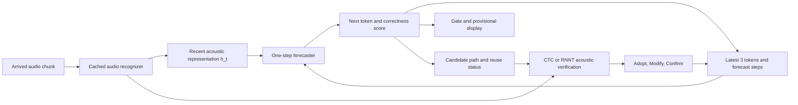

# LibriSpeech 960h benchmark and learning setup plan

**Current priority, 2026-11-12:** the user selected [prediction plus inexpensive acoustic correction](predict_correct_acceleration_plan_2026-11-12.md) as the next compute-acceleration direction. First establish correction/state-recovery feasibility with the existing backbone and 100h data. The 114M/960h recipe below remains a separate, unexecuted scale-up proposal.

This is a proposed next-experiment configuration. [Current conclusions](conclusion_and_next_steps.md) take precedence for completed work and supported results.

**The public baseline evaluation step has been completed:** The official Streaming Zipformer 66.11M below was applied to the entire test 5,559 utterance with FP32·320ms chunk-wise greedy to obtain WER 3.058/7.820% (official 3.06/7.79%). [Follow the execution conditions, evaluation code, original log, and limits](baseline_zipformer_2026-11-11.md). This step is a public checkpoint evaluation and is distinguished from 114M FastConformer·New Forecast Training. The study setting suggestions below do not change to actual settings.

**2026-11-12 The first strong-backbone experiment of our forecaster has also been completed:** On this fixed Zipformer, 4.60M full/band2 forecasters were trained for each 100h × 15 epoch with the same random initialization, and the entire test was evaluated after independent dev gate calibration. The paired average display gain of band2+gate was clean 89.58ms / other 70.28ms,, and the native probability + gate without additional model was 59.27/53.74ms. The actual test errors are not the same as 0.375/0.537 vs. 0.335/0.507 tokens/100native tokens, respectively. The actual text KV is 29.9KiB,, the forecast cost is about 1.4ms/chunk, and the voice history still increases. [Follow learning·evaluation·precision·CI·display diagnosis](zipformer_ours_2026-11-12.md). Even with random initialization, this pilot's display gains were achieved, but the new 960h forecaster, 114M acoustic backbone, FastEmit, and commit latency are still subject to separate verification.

Plan date: 2026-11-11, America/Los_Angeles. The user selected LibriSpeech 960h as the main benchmark. Model and training hyperparameters below are unexecuted initial proposals. The [configuration JSON](../configs/librispeech960_benchmark.json) records a research plan, not a runnable configuration consumed by the current trainer.

**Reflection of follow-up 100h results:** Evaluation of the short context accumulation model has been completed. In this structure, the P=3→32 expansion gain was not observed, but it did not replace the full context AR, and the attempted rollout fine-tune did not improve it. [Review of correction results Follow ](results_review_2026-11-11.md). The main track of 960h is a single pass forecast/gate verification on a strong common backbone, and the short context/rollout/noise is a separate ablation that does not assume any effect. The previous 48 ms results of 2-pass were withdrawn.

**Contrast more recent identical structures:** The above failure is a result of the early slotted short model. W1a, which learned the 3 token window with the same AR decoder and initial value, maintained about 85–96% of the WER improvement compared to B0 of the entire AR (test-clean 320 ms: 14.75% vs. 14.55%). Therefore, the following short context comparison starts with a strict window of the same AR decoder instead of a slot structure, and controls the initial value and pre-training budget. The cache increment calculation results are also stored. [Latest conclusions and figures](conclusion_and_next_steps.md)

**Subsequent modification/Reflection of actual cache verification:** The main candidate for the current short context is **AR decoder model where each layer only sees the current and previous 2 positions**. The strict 3 token window is maintained as a separate control. Currently, the maximum self-attention text capacity of the 4 layer is 9 tokens, and if the number of layers is increased to 6/8, even the same band = 2 will be changed to 13/17 tokens. The cache 3 location and the raw text context 3 token are not interpreted identically. The actual completion status of KV release, long stream, additional seed, and screen stabilization follows [the subsequent four experiments](followup_experiments_2026-11-11.md). Disabling the text cache does not fix the audio memory.

Additional `prescale` checks suggest much gain recovers old CTC emission waiting. First compare early-display policies on a public 960h streaming checkpoint and test whether gains remain with stronger acoustics. Correct-and-kept logistic gating and frozen-threshold transfer were tested; joint token-CE/confidence-BCE training remains proposed.

## User intent and structure to augment

The user's core idea is **bounded recent-state prediction, recurrent feedback, acoustic verification on arrival, acceptance/correction and reuse of prepared computation**. It does not require retaining noise or only enlarging the acoustic model. The then-recommended implementation is an audio-conditioned AR window informed by matched-architecture controls, not every element of original FGN.

During forecasting, hold arrived acoustic representations fixed while sliding the text window to generate continuations. Update audio and verify candidates after new input. High gate confidence does not immediately imply irreversible commitment; distinguish provisional display from acoustically verified commitment. Computational reuse remains an objective separate from demonstrated display benefit.

Differences between current implementation and target:

| Item | Verified implementation | Next target / unresolved choice |
|---|---|---|
| Acoustic recognizer | 17.28M, 100h, CTC/AED | Proposal: approximately 114M FastConformer-Hybrid trained from scratch on 960h |
| Forecaster | Strict 3-token window of the same AR decoder; latest W1a evaluation | Compare forecaster capacity separately |
| Audio context | Current WindowPredictor reads all arrived encoder history through `enc[None]` | Also bound audio context, for example to 2.56 seconds, consistently in training and inference |
| Complete state | Limiting text alone does not establish bounded total system state | Bound layer caches, audio ring buffers and candidate caches; measure real peak memory |
| confidence | Separate logistic gate output/correct answer/maintenance label experiment | token CE + actual correct answer confidence BCE joint learning proposal |
| Cumulative learning | Tried hard-token rollout fine-tune does not improve | Make single-step/same initial value contrast first and rollout/noise is ablation |
| Execution settings | JSON is for planning purposes and is not currently read by the trainer | CUDA·official backbone recipe·manifest·forecast adapter integration required |

114M is the approximate size of the entire recognition model (including encoder and CTC/RNNT related parts). “114M In addition to the encoder, a decoder is also added separately” so there is no double calculation. There is no GNN message passing in the current code, and the mere fact of using candidate tries does not make it a GNN-based model.

### A candidate for expansion of the forecast itself

Parameter counts only: instantiate current `avs/model.py` Decoder and 512-dimensional audio adapter on meta tensors, vocabulary 1024, with cross-attention. No training or GPU-memory measurement; counts exclude acoustic backbone/confidence head.

| Candidate | Hidden / layers / heads / FF | Decoder + audio-adapter parameters |
|---|---|---:|
| Small control | 256 / 4 / 4 / 1024 | 4,871,168 (approximately 4.9M) |
| Intermediate scaling proposal | 384 / 6 / 6 / 1536 | 15,185,152 (approximately 15.2M) |
| Large control | 512 / 8 / 8 / 2048 | 34,683,392 (approximately 34.7M) |

**The new recommended candidate is approximately 114M recognizer + approximately 15M forecaster**, with 5M/35M as the scale comparison. The user has not finally selected this size or started actual training. The original 5–10M proposal leaves a small contrast candidate. Rather than determining the cause of improvement solely as a result of simultaneously changing the acoustic model and forecaster, we compare forecast size, context, and learning method on the same fixed backbone.

### Execution order of large model training

1. Raw sound collection, official checksum verification, 960h train manifest union, NeMo format conversion, and list of dev roles have been completed. Next, check the actual data loading in the learning environment and prepare the train-only BPE 1024 and features and statistics in separate paths.
2. Fix the CUDA environment and upstream code version. It integrates the official cache-aware FastConformer recipe and does not treat the existing 17M dedicated MPS/CPU learning code as a large model executor.
3. Learn the sound recognizer first. In the first hundreds of steps, numerical stability, memory, and learning voice volume per second are measured, and global batch/gradient accumulation and total GPU time are calculated. Check the causality of the recognizer itself, cache increment matching, WER, and emission timing.
4. Fix the acoustic recognizer to learn the forecast. **RNNT's LSTM prediction network and the current Transformer cross-attention forecaster are different modules**, so the RNNT weights of the new backbone cannot be used as the initial value of the existing AR decoder. Create a common AR forecast pre-training or separate initialization procedure, and provide the same initial value and the same pre-training budget to the full context/window model.
5. When combining the token CE of the forecast model and the correct answer BCE, the actual generated candidate is aligned with the correct answer to create a confidence label. These two losses are the losses of the forecast stage and are distinguished from the RNNT/CTC loss of the sound stage. Set the learning/inference conditions of generation prefix, number of previous steps, and voice cutoff.
6. After fixing the gate threshold in dev's separate reference value correction split, the entire test is evaluated. Token accuracy/route hit, WER, display/stable/commit latency, mismark/revocation, total calculation/memory are compared together.

Plan CUDA GPU training, initially profile one 48–80GB device, then choose GPU count from measured batch/loss/rollout memory. This does not guarantee fit at a particular capacity. M5 Pro remains useful for development/validation; do not extrapolate the 17M Mac training time directly. Full audio/manifests are prepared, but GPU rental, scale-up environment setup and expanded training were not performed.

## data range

| Purpose | Official split | Current status |
|---|---|---|
| Training | train-clean-100 + train-clean-360 + train-other-500 | Audio, text, checksums and manifests verified; 281,241 training utterances / 961.054 hours |
| Model selection·Gate fitting·Reference value correction | dev-clean / dev-other | Original prepared; Separation by speaker using the new protocol below |
| Final evaluation | Full test-clean / test-other | 2,620 / 2,939 utterances prepared; do not substitute a 500-utterance sample in the final report |

Use the union of the three official training splits without adding the existing 100h twice. Do not arbitrarily change clean/other ratios or omit other. Report utterance/hour counts before and after exclusions for corruption or duration limits. Do not silently apply official `max_duration=20` and omit longer utterances.

Controlled comparison does not use external speech, pseudo labels, external text, pre-learning weights, or external LM. Augmentation starts with speed perturbation 0.9/1.0/1.1 and SpecAugment created from the training material. Augments do not count as additional actual data time collected.

OpenSLR lists approximately 23G + 30G archives for train-clean-360/train-other-500. Extraction, features and checkpoints need additional space. At float16, 80 features and 100fps, 960h features alone are about 55.3GB. Retain FLAC and needed caches rather than duplicate all audio as WAV/features. Plan 150–250GB, then revise from actual downloads, caching and checkpoint policies.

Extend preparation with `--scope 960h` and resume the two added splits from official ELDA. Verify all 7 archive MD5s, FLAC STREAMINFO, audio/text correspondence and cross-split utterance/speaker separation. `data/processed/manifests/train-960.jsonl` combines training only. Actual counts, hours and sources are in the [inventory](../data/reports/librispeech_inventory.md); waveforms were not all fully decoded.

Source: [Official LibriSpeech splits, sizes and CC BY 4.0](https://www.openslr.org/12/).

## Divide the roles of dev materials in advance

The new 960h protocol fixes dev roles by speaker as below, seed 20261111, in a separate namespace preserving existing G/H evaluation/gate files.

| split | model selection | gate fit | gate reference value correction |
|---|---:|---:|---:|
| dev-clean 40 speaker | 20 speaker | 10 speaker | 10 speaker |
| dev-other 33 speaker | 17 speaker | 8 speaker | 8 speaker |

Model selection chooses learning rate, checkpoint, context and rollout; gate fitting learns confidence; calibration selects error/retraction operating points. Freeze these for full test evaluation. Repeated inspection of earlier 500-utterance test samples means the full test cannot be claimed as completely unseen blind evaluation.

Utterance-role assignments remain local in `data/processed/protocols/librispeech960_v1/dev_partitions.json`; publish speaker/utterance counts and hours in the [protocol aggregate](../data/reports/librispeech960_protocol.json). Fit tokenizers and normalization on training data only.

## Comparison models and fairness

1. **Reproducible baseline:** Fixes the official Streaming Zipformer 66.11M. official recipe and evaluation mode. The evaluation reproduction of the public 960h checkpoint and the reproduction that we learned from scratch are displayed separately. Initially, the pipeline can be verified by public checkpoint evaluation, but this is not directly written as a learning result.
2. **Common acoustic backbone of the proposed method:** About 114M cache-aware FastConformer-Hybrid is learned from scratch on 960h. After fixing the same weights, we isolate the predictor effect by comparing full context AR, short context AR, short context rollout, noise/ensemble, and gate. The difference between 66M and 114M is not claimed to be due to the effect of the method itself.
3. **Reference model:** The NVIDIA model trained with offline CR-CTC and large-scale mixed data is reported in a separate table. The public FastConformer pretrained is also a NeMo ASRSET learning model, so it does not replace the 960h-only scratch model.

Official normal-scale Zipformer 66.11M reports 3.06/7.79% clean/other WER at 320ms chunk-wise greedy, 3.05/7.69% with modified beam. The supplied 3.17/8.24% is from the earlier `pruned_transducer_stateless7_streaming` recipe. Do not mix recipe/checkpoint/search/context into one baseline.

Sources: [icefall results](https://github.com/k2-fsa/icefall/blob/master/egs/librispeech/ASR/RESULTS.md), [official checkpoint](https://huggingface.co/Zengwei/icefall-asr-librispeech-streaming-zipformer-2023-05-17), [NVIDIA FastConformer card](https://huggingface.co/nvidia/stt_en_fastconformer_hybrid_large_streaming_multi).

## Similarities and differences between Zipformer and cumulative FGN

The official Zipformer `context_size=2` means its text prediction network uses the last two tokens. It also updates history with its own outputs and generates sequentially at inference. Short context or chained generation alone is therefore not a new distinction.

Basic RNN-T trains the prediction network on gold transcript prefixes and sums over audio/token alignments; it is not multi-step rollout on repeatedly fed incorrect predictions. The proposed direction fixes arrived audio, feeds predicted tokens back and learns future-step losses before verification after new input.

| Item | Official Zipformer baseline | Proposed short-context recurrent predictor |
|---|---|---|
| Text context | Last 2 tokens, default BPE 500 | Start with last 3 tokens; ablate 2/4/8 |
| Acoustic conditioning | Prediction network processes text; encoder and joiner combine it with audio | Forecaster directly conditions on arrived acoustic representations |
| Inference | Sequential token generation and history updates | Feed next-token forecasts back to accumulate candidate paths |
| Basic learning | Correct answer transcription prefix + RNN-T alignment marginalization | Separate comparison of rollout loss in steps 1→2→4 using the generated prefix |
| Decision target | Recognition of observed speech | Forecasting, display and potential work reuse before next-chunk verification |

Token lengths depend on tokenizer. Two/three tokens under baseline BPE 500 and proposed BPE 1024 are not equal word counts. All predictors within a proposed-method comparison use the same tokenizer.

Sources: [Zipformer train.py](https://github.com/k2-fsa/icefall/blob/master/egs/librispeech/ASR/zipformer/train.py), [gold-prefix input in model.py](https://github.com/k2-fsa/icefall/blob/master/egs/librispeech/ASR/zipformer/model.py).

## Setting up a common acoustic backbone

Start from the official FastConformer-Hybrid architecture. The batch/epoch/chunk settings below are resource-aware proposals, not a full reproduction of the paper's training.

| Item | Initial setting |
|---|---|
| Size | Approximately 114M, 17 layers, hidden 512, 8 attention heads, FF expansion 4 |
| Audio features | 16kHz mono, 80-bin log-mel, 25ms window / 10ms hop |
| subsampling | 8 times, output interval 80ms, causal convolution·downsampling, LayerNorm |
| tokenizer | train transcription only SentencePiece BPE 1024, shared on all internal comparisons |
Learning | streaming | chunk 160/320/640ms Select with equal probability |
| Per-layer past audio context | 2.56 seconds = 32 encoder frames; divisible by chunks of 2/4/8 frames |
| NeMo attention setting plan | `chunked_limited`, `[[32,1],[32,3],[32,7]]`, probability angle 1/3 |
| Acoustic loss | Official Hybrid RNNT+CTC mixture, `ctc_loss_weight=0.3` |
| FastEmit | Use 0.005 as a starting point; Same backbone | for all internal comparisons
| optimizer | AdamW, beta 0.9/0.98, weight decay 0.001 |
| scheduler | official NoamAnnealing, d_model 512, warmup 10,000 update |
| Learning rate | Official Noam scale 5.0, not fixed learning rate 5.0; peak about 0.00221 under the official formula |
| epoch | Set maximum 200 as the first budget, select dev model, select checkpoint in split; Convergence is judged by the actual curve |
| effective global batch | 256 ignition is proposed as a starting plan. It consists of microbatch and gradient accumulation and records actual voice time/step |
| microbatch | Memory measurements starting from 8 per GPU; Variable length bucketing. 2 GPU × 8 × accumulation 16 = global 256 Example |
| Numeric precision | Start official reproduction with FP16 + GradScaler; retain FP32 for numerically sensitive loss operations |
| checkpoint average | dev model selection 5 checkpoints; Uneven with test WER |

In 8 times subsampling, encoder 2/4/8 frame is 160/320/640ms chunk. This is not denoted as average word delay. Record look-ahead, frontend delay, encoder time, decoder time, display and confirmation time within the same chunk, respectively. icefall's `--chunk-size` is a different number for the same time, so convert from ms to each implementation unit.

The official Stateful Conformer paper reports effective batch 2048 and at least 200 epochs on LibriSpeech. Proposed global batch 256 is a resource-aware change, not identical-recipe reproduction. Explicitly override tokenizer, length filters, context and scheduler in official configs, and pin branch/environment versions before execution.

Sources: [official streaming config](https://github.com/NVIDIA-NeMo/Speech/blob/main/examples/asr/conf/fastconformer/hybrid_cache_aware_streaming/fastconformer_hybrid_transducer_ctc_bpe_streaming.yaml), [Stateful Conformer](https://arxiv.org/abs/2312.17279).

## Forecast model and learning settings

- The common acoustic backbone is fixed. The forecast model uses the hidden 256, 4 layer and the approximately 5–10M level of the head 4, FF 1024 as the starting point, but the exact number of parameters is counted after implementation. The adapter that converts the backbone 512-dimensional acoustic representation into the forecast model dimension is also included in the parameters and calculation amount.
- The main contrast in the short context is the same audio-aware AR decoder in the form of a strict 3 token window. Compare with full context AR with the same initial weight and the same pre-training/training budget. It is not combined into one category with the results of a separate FGN-type slot structure.
- The main setting is the past P=3 token, one-time output H=1 token. It is created cumulatively by pushing the fixed past context one space at a time. Audio conditions only use expressions that have arrived so far, and the initial window is set to the most recent 2.56 seconds.
- **Specifies the lead condition.** Input includes which token of the current prefix is ​​the forecast after the corresponding voice cutoff (initial 0–3). This is the number of forecast steps known from actual inference and is not inputting future speech. In the subsequent 100h experiment, missing this condition resulted in a significant drop in cumulative path performance.
- Single-step/lead condition learning is the first standard. The 10 epoch single stage of the previously proposed 20 epoch → 5 epoch 2 stage → 5 epoch 4 stage rollout is left only as **optional ablation**. Since deterioration was observed in the 3 epoch rollout fine-tune of 100h, it is not assumed that this curriculum is advantageous in the expanded model. The comparison group uses the same data and learning budget and reports the additional forward cost of multi-level learning.
- AdamW lr 0.0003, warmup 2,000 update, cosine decay, weight decay 0.01, clip 1.0 as the start. The above values ​​are suggestions before verification and are not to be used interchangeably with the Noam settings of the acoustic backbone.
- The basic loss proposals are token CE and correctness confidence BCE at each rollout stage. `L = mean_h(CE_h) + lambda * mean_h(BCE_h)`, start from lambda 0.1 and compare 0.03/0.1/0.3 in dev. The confidence label is created based on the actual correct answer, and the label matching the model output is not used instead.
- The prefix generated by the model and the incorrect prefix of the actual streaming decoder are also used. Specify how the starting position/insertion/deletion are aligned to the correct answer. The initial hard-token rollout detaches token selection and learns shared parameters with each step loss. It is not full path differentiation through argmax and does not claim to be equivalent to the continuous state rollout of the original FGN.
- The deterministic model is used as the standard first, and the noise injection version is compared separately. It is not assumed that CE+BCE alone utilizes noise or reproduces the distributional learning of the original FGN. The stochastic version must specify the new noise and appropriate distribution loss for each time step.

Primary matched-backbone comparison: full-context AR versus layer-band2 AR. Strict 3-token windows are controls; rollout/noise are separate ablations. Current 100h repeats initialize both from the existing decoder. A new backbone has no matching Transformer initialization, so use matched random initialization/training budgets; any shared AR pretraining must be budget-matched. Screen with one predictor seed and repeat main comparisons with three. Distinguish acoustic-backbone from predictor-seed coverage.

The mere fact that the observed values ​​of P=3 and P=32 are similar does not confirm the equivalence of the two settings or the cause of the gap with the overall AR. A contrast in which the same AR structure is learned in a short context and a predetermined non-inferiority criterion are needed. Token ID sizes such as `P*8` do not report the entire actual state memory, but measure K/V·logp·trie·shared voice state·temporal tensor in the same range.

## Remaining preparations before evaluation and implementation

Separate final WER, first display, stable display after the last revision and commitment latency. Count reference correctness, later-output agreement, all retractions/replacements and incorrect exposure time separately. Compute mean/P50/P95 against identical word references; supplement post-hoc metrics with independent alignment and paced streaming.

Measure complete time/RTF and memory on the same device, including encoder, forecaster, gate, both passes and merging. Report work per audio second and a fixed wall-clock budget. Primary comparisons match false-display/retraction rate or final WER.

Current `train_stage1.py` fixes the 17M model and MPS/CPU choices and does not directly support the proposed config. Full audio/training-union/NeMo lists are ready; actual trainer loading remains unverified. Current tokenizer/statistics fit train-clean-100, so use a separate 960h namespace and train-only fitting. Integrate CUDA/official recipe and separate paths; measure memory/throughput for 200–500 steps before estimating training time. No GPU rental or expanded training was performed.
