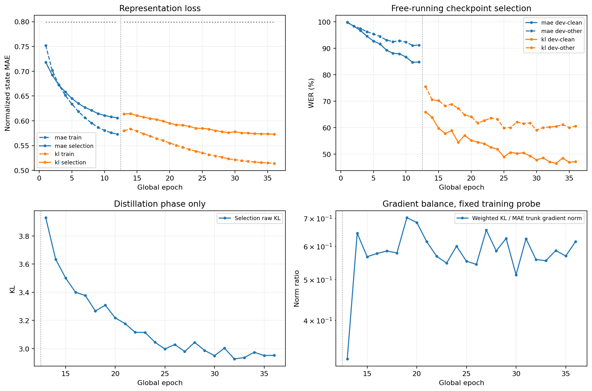
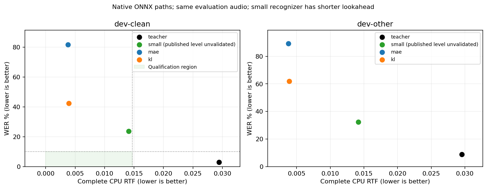

# A2 audio-only qualification and small-Zipformer control — 2026-11-15

A2 qualification FAIL: selected kl checkpoint has dev-clean WER 42.303%, complete cost 13.32% of the same-run teacher and 12.95% of the previous teacher. Targets are WER <10% and cost <=50% against both denominators.

Completed 36 phase epochs and 800-utterance held-out-role development evaluation in 2.09 hours from runner start, excluding prior engineering/preparation and the later small-model diagnostic audit. One seed; no test splits. Runner completion: 2026-11-15T02:01:55.207470-08:00.

## WER and complete cost

| Split | Path | WER % | State MAE | Total ms/chunk | RTF | RTF + file IO |
|---|---|---:|---:|---:|---:|---:|
| dev-clean | teacher | 2.933 | 0.0001 | 8.942 | 0.02944 | 0.02973 |
| dev-clean | small | 23.706 | N/A | 4.252 | 0.01411 | 0.01424 |
| dev-clean | mae | 81.634 | 0.5730 | 1.150 | 0.00379 | 0.00392 |
| dev-clean | kl | 42.303 | 0.5333 | 1.191 | 0.00392 | 0.00405 |
| dev-other | teacher | 8.817 | 0.0002 | 8.935 | 0.02956 | 0.02987 |
| dev-other | small | 32.352 | N/A | 4.240 | 0.01417 | 0.01430 |
| dev-other | mae | 89.296 | 0.6200 | 1.146 | 0.00379 | 0.00392 |
| dev-other | kl | 61.915 | 0.5960 | 1.187 | 0.00393 | 0.00406 |

Teacher is the existing public 66.11M Zipformer; small is the public English export named 20M. A2 has 9,597,696 newly trained frontend/head parameters and shares the frozen teacher prediction network/joiner. Public recognizers and the local 100h student have different training budgets. Small-model states are not teacher-compatible, so state MAE is not compared for that model.

**Small-model comparison limitation:** the cold-start native streaming result here is much worse than the source card's published test WER of 3.94/9.79%. These are different splits and incompletely matched publication conditions; the reported performance level is not established by this run. The official supplied waveform reproduces the documented demo text, and an independent native-engine corpus audit is recorded separately. Do not treat the table's small model as a successfully reproduced strong published benchmark. The frozen primary results, feature settings and checkpoints are preserved.

## Qualification

| Phase | Clean WER <10% | Cost / same-run teacher | Cost / previous teacher | All conditions pass |
|---|---|---:|---:|---|
| mae | False | 12.86% | 12.51% | False |
| kl | False | 13.32% | 12.95% | False |

The chosen phase is **kl**. Candidate selection used only the model-selection role; the separate final role did not select checkpoints or the phase.

| Phase | Selected phase epoch | Selection clean WER % |
|---|---:|---:|
| mae | 12 | 84.778 |
| kl | 21 | 46.540 |

The cost condition uses complete CPU RTF on identical dev-clean audio and must hold against both denominators. The previous teacher pipeline used a PyTorch decoder; this run uses the native ONNX decoder. Passing 10%/50% is an entry gate for later B/C studies, not teacher-level WER parity or proof of a new ASR method. No FGN training or adaptive encoder omission was performed.

## Interpretation

The selected A2 does not qualify because recognition error remains above the declared 10% gate. Better representation MAE and lower runtime do not compensate for that failure. This result applies to this fixed architecture/distillation recipe and budget; it does not establish a general limit on fbank-based encoders or FGN prediction.

The native small recognizer has dev-clean WER 23.706% and complete cost 47.93% of the same-run teacher. Selected A2 has +18.596pp WER difference and 0.28x its cost. Upstream training and the small model's shorter native window differ, so this is an operating-point reference rather than an iso-training architecture comparison.

The MAE-only checkpoint and KL checkpoint also differ in training duration. There is no matched-duration MAE-only continuation control; their difference is not a causal estimate of the effect of KL alone.

## Paired WER differences

| Split | Comparison | Delta pp | Paired 95% CI |
|---|---|---:|---|
| dev-clean | mae-minus-teacher | +78.701 | [+77.435, +79.918] |
| dev-clean | mae-minus-small | +57.928 | [+55.300, +60.226] |
| dev-other | mae-minus-teacher | +80.479 | [+79.209, +81.736] |
| dev-other | mae-minus-small | +56.944 | [+54.379, +59.327] |
| dev-clean | kl-minus-teacher | +39.370 | [+37.696, +40.955] |
| dev-clean | kl-minus-small | +18.596 | [+15.862, +21.099] |
| dev-clean | kl-minus-mae | -39.331 | [-40.819, -37.671] |
| dev-other | kl-minus-teacher | +53.099 | [+51.323, +55.016] |
| dev-other | kl-minus-small | +29.563 | [+26.587, +32.311] |
| dev-other | kl-minus-mae | -27.380 | [-28.978, -25.762] |

Intervals resample utterances jointly and are conditional on these selected checkpoints. They do not capture seed/optimizer/checkpoint-selection variability. No equivalence is inferred from an interval containing zero.

## Cost components

CPU batch 1, one thread. Resident raw waveform to free-running native transcription; fbank, normalization, caches, A2 head, decoder, conversion/Python overhead included. Model load and reference metrics excluded; file IO additionally reported. No microphone waiting/display latency.

| Split | Path | Fbank | Frontend + head | Decoder | Other | Total |
|---|---|---:|---:|---:|---:|---:|
| dev-clean | teacher | 0.210 | 8.539 | 0.153 | 0.040 | 8.942 |
| dev-clean | small | 0.209 | 3.896 | 0.128 | 0.018 | 4.252 |
| dev-clean | mae | 0.209 | 0.851 | 0.080 | 0.010 | 1.150 |
| dev-clean | kl | 0.209 | 0.852 | 0.120 | 0.010 | 1.191 |
| dev-other | teacher | 0.212 | 8.531 | 0.151 | 0.041 | 8.935 |
| dev-other | small | 0.210 | 3.886 | 0.125 | 0.019 | 4.240 |
| dev-other | mae | 0.211 | 0.850 | 0.075 | 0.011 | 1.146 |
| dev-other | kl | 0.210 | 0.853 | 0.112 | 0.010 | 1.187 |

All component values are ms/chunk, measured on Apple M5 Pro 24GiB, CPU batch 1 / one thread. Two sequential repetitions reverse path order after excluded warmup; repeated transcripts match. Neural paths all use FP32 ONNX. A2 output denormalization, all cache handoffs and native token decoding are counted. Reference-state scoring and disk IO are outside the primary timer; IO-inclusive RTF is shown separately. Model loading is a one-time excluded startup cost.

## Architecture, training and checks

- Initial causal stride 4, twelve width-256 residual blocks and a joint chunk output head. All eight outputs can use the final arrived feature. Batch/stream outputs, future-chunk isolation and stride phase passed preflight. Tiny fitting used a disposable model, not a warm start.
- MAE: 12 epochs; best selected by fixed-window representation MAE. KL: all 24 additional epochs completed after the representation gate, initialized from MAE-best; one-time train-only trunk-gradient calibration and two-epoch coefficient ramp. Final KL checkpoint selected by free-running selection-role clean WER. MAE-only and last checkpoints remain preserved.
- All 28,539 train-clean-100 utterances contribute each epoch. Eight-chunk beginning/end/random windows directly supervise utterance starts. Causal history is available as input; future teacher states and native contexts supervise losses only. No reference transcript or teacher state is an inference input.
- The shared teacher distribution is native greedy-context distillation, not new reference-supervised transducer training. WER is obtained from independently generated transcripts and is not fixed by construction.
- The one-time KL coefficient is a train-only gradient-scale calibration, not the adaptive GradNorm algorithm. A fixed four-utterance probe monitors local weighted trunk-gradient ratios; it does not reconstruct every update or establish causal loss dominance throughout training.
- The initial untrained PyTorch path was approximately 10.8ms/chunk. Equivalent first/step ONNX graphs were prepared during MAE training, before held-out collection, without changed weights or quantization. Initial untrained ONNX timing was approximately 1.3ms/chunk during GPU training, not a qualification result. Final exported checkpoints have their own numerical and real-audio token checks.
- Existing teacher and small adapters match independent sherpa-onnx outputs on eight raw-audio decodes. The small model has a native 39-frame window, teacher/A2 45; all hop 32 and emit eight frames. Its available input window is 60ms shorter. Native endpoints/tail padding can yield slightly different chunk counts. Compare RTF per original audio duration, not only per chunk.
- The same project dev roles were used before this study. Current selection/evaluation roles are speaker-disjoint, but this is not an untouched external test. One seed and one bounded recipe cannot settle all cheap audio encoders or FGN prediction value.
- Training source/input hashes, exact epoch/optimizer-step counts, selected checkpoints, unchanged decoder/teacher files, FP32 export identities, raw coverage, repeated transcripts and timing sums passed verification. No live microphone, user-perceived display latency, adaptive fallback, mobile power or long-stream recovery evaluation is claimed.

PyTorch/ONNX real-audio token checks on eight model-selection utterances per checkpoint: {"mae": true, "kl": true}. The per-checkpoint random-stream numeric tolerance is 2e-4; exact token checks and numerical closeness are recorded separately.

## State baselines and training resources

| Split | Train-mean constant MAE | Sampled train-median constant MAE |
|---|---:|---:|
| dev-clean | 0.7930 | 0.7925 |
| dev-other | 0.7993 | 0.7991 |

The median estimate uses 65,536 training frames, not exact population medians. Direct supervision covers 1,162,121/1,164,469 distinct chunks (99.80%) and the first chunk of 28,437/28,539 utterances. Error reductions are not recovered-information percentages.

| Phase | Epoch wall minutes | Maximum sampled MPS driver GiB |
|---|---:|---:|
| mae | 38.64 | 3.178 |
| kl | 77.55 | 3.255 |

KL coefficient: 0.026009, ramped over two epochs. Epoch wall time includes validation and CPU selection. Driver samples are not total system RAM or continuous memory peaks.

[Protocol](../experiments/predict_correct_a2_v1/README.md) · [Aggregate results](../experiments/predict_correct_a2_v1/artifacts/results.json) · [Prior review](predict_correct_review_2026-11-14.md)

## Post-hoc small-model native audit

Independent sherpa-onnx 2.0.1 decoded all 800 evaluation utterances. Every token sequence and chunk count matches the primary adapter. The supplied upstream demo text also matches exactly.

| Split | Native-engine WER % | Utterances | Native minus primary word errors |
|---|---:|---:|---:|
| dev-clean | 23.694 | 400 | -1 |
| dev-other | 32.352 | 400 | +0 |

Native formatting differs from the primary piece-to-text normalizer in 161 hypotheses (primarily leading apostrophes). This changes only one word error on clean and none on other. The minor text-format difference is distinct from the large published-level gap; the main table retains the frozen common normalization.

This checks implementation agreement, not agreement with the source paper's full test benchmark. Waveform scaling, high-frequency settings, tail padding and leading-silence diagnostics did not establish a consistent repair. The cause of the published-level gap remains unresolved. These diagnostic variants did not alter the primary evaluation or A2 qualification.

[Source-model card](https://huggingface.co/desh2608/icefall-asr-librispeech-pruned-transducer-stateless7-streaming-small) · [Official example](https://k2-fsa.github.io/sherpa/onnx/pretrained_models/online-transducer/zipformer-transducer-models.html#csukuangfj-sherpa-onnx-streaming-zipformer-en-20m-2023-02-17-english) · [Independent audit](../experiments/predict_correct_a2_v1/artifacts/small_reproduction_audit.json)
