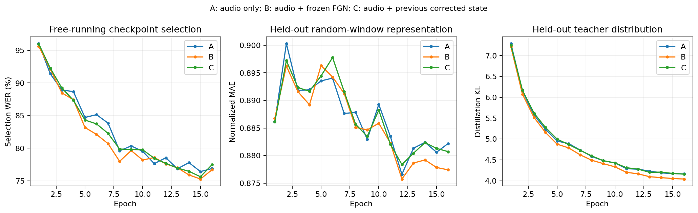
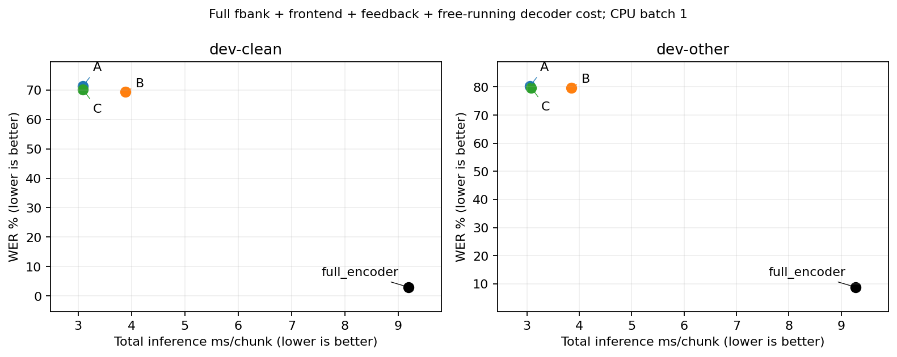

# Fbank prediction-correction three-way pilot — 2026-11-14

No tested cheap path retains the full encoder's accuracy while meeting the compute-saving target. B meets the declared practical-plus-paired-CI WER improvement criterion over A on 1/2 splits. 0/6 cheap-path operating points meet both the full-encoder WER tolerance and compute-saving targets. These separate checks distinguish prior usefulness within this small student from accuracy-preserving encoder acceleration.

Completed A/B/C training and held-out dev decoding in 1.36 hours from runner start, excluding prior fbank extraction and engineering checks. Frozen native decoder; own corrected-state feedback, no teacher-state inference input. No test data used.

## WER and complete inference cost

| Split | Path | WER % | Normalized state MAE | Total ms/chunk | RTF | RTF including audio file IO |
|---|---|---:|---:|---:|---:|---:|
| dev-clean | full_encoder | 2.933 | 0.0001 | 9.195 | 0.0303 | 0.0306 |
| dev-clean | A | 71.401 | 0.8590 | 3.093 | 0.0102 | 0.0103 |
| dev-clean | B | 69.339 | 0.8588 | 3.889 | 0.0128 | 0.0129 |
| dev-clean | C | 70.082 | 0.8618 | 3.094 | 0.0102 | 0.0103 |
| dev-other | full_encoder | 8.817 | 0.0002 | 9.281 | 0.0307 | 0.0311 |
| dev-other | A | 80.380 | 0.8749 | 3.063 | 0.0101 | 0.0103 |
| dev-other | B | 79.718 | 0.8754 | 3.849 | 0.0127 | 0.0129 |
| dev-other | C | 79.746 | 0.8788 | 3.082 | 0.0102 | 0.0103 |

All paths use the same nominal 320ms chunk schedule, 45-frame feature availability and baseline tail padding; no 160/640ms sweep was run here. A uses fbank + causal conv only. B adds one frozen deterministic FGN forecast, based on corrected history. C adds the previous corrected state directly. Common audio/head initialization; prior projections start at zero. Frontend parameters are A 745,600 / B 7,135,104 (including frozen FGN) / C 811,136. These are not matched total-parameter or iso-compute systems.

Same-set constant-mean MAE baselines: dev-clean 0.7930, dev-other 0.7993. MAE reductions are not recovered-information percentages.

## Paired WER comparisons

| Split | Difference | WER delta, percentage points | Paired 95% CI |
|---|---|---:|---|
| dev-clean | B-minus-A | -2.062 | [-3.254, -0.914] |
| dev-clean | B-minus-C | -0.743 | [-1.872, +0.387] |
| dev-clean | C-minus-A | -1.319 | [-2.341, -0.290] |
| dev-other | B-minus-A | -0.662 | [-1.704, +0.402] |
| dev-other | B-minus-C | -0.028 | [-1.014, +0.930] |
| dev-other | C-minus-A | -0.634 | [-1.763, +0.437] |

Negative B-minus-A deltas favor prediction. Intervals resample utterances jointly; they do not measure seed variance. Lack of significance does not prove equivalence. A practical B-versus-A improvement threshold of 0.5pp and a full-encoder WER-degradation tolerance of 0.5pp were declared before full training.

## Interpretation

- dev-clean: B changes WER by -2.062pp versus A and -0.743pp versus C. Its full inference cost is 1.26x A and 1.26x C. Use the paired intervals above to assess those quality differences.
- dev-other: B changes WER by -0.662pp versus A and -0.028pp versus C. Its full inference cost is 1.26x A and 1.25x C. Use the paired intervals above to assess those quality differences.

B's additional forecasting benefit over simply retaining the previous corrected state is not established on either split: both B-minus-C intervals include zero. This does not prove equivalence. It matters because B is the more expensive path.

The cheaper runtime comes with a large recognition failure. It does not establish useful encoder-skipping acceleration. Improve and diagnose the cheap audio reconstruction/distillation path before spending more training on a larger frozen state predictor. This result is limited to the fixed small-conv recipe, its causal sampling/context constraints and the frozen-prior training contract; one pilot cannot settle every prediction-correction architecture.

## Operating-point checks

- dev-clean: B improves on A by the declared practical amount: True; beneficial paired CI excludes zero: True; B/full-encoder speedup 2.36x; within full-encoder WER tolerance: False; B/A compute ratio 1.26.
- dev-other: B improves on A by the declared practical amount: True; beneficial paired CI excludes zero: False; B/full-encoder speedup 2.41x; within full-encoder WER tolerance: False; B/A compute ratio 1.26.

## Cost accounting

CPU batch-1 one-thread streaming replay from resident raw waveform. Includes fbank, normalization, conv caches, FGN prediction, correction, corrected-state memory update, token decoding and Python/array conversion overhead. Reference metrics and file IO excluded from primary runtime; IO-inclusive RTF reported separately. No microphone wait time or UI latency.

| Split | Path | Fbank | Audio network | FGN forecast | Correction head | Feedback | Decoder | Other | Total |
|---|---|---:|---:|---:|---:|---:|---:|---:|---:|
| dev-clean | full_encoder | 0.208 | 8.636 | 0.000 | 0.000 | 0.000 | 0.333 | 0.018 | 9.195 |
| dev-clean | A | 0.207 | 2.626 | 0.002 | 0.040 | 0.001 | 0.202 | 0.015 | 3.093 |
| dev-clean | B | 0.208 | 2.643 | 0.696 | 0.055 | 0.041 | 0.225 | 0.022 | 3.889 |
| dev-clean | C | 0.207 | 2.614 | 0.002 | 0.052 | 0.001 | 0.203 | 0.015 | 3.094 |
| dev-other | full_encoder | 0.211 | 8.714 | 0.000 | 0.000 | 0.000 | 0.336 | 0.020 | 9.281 |
| dev-other | A | 0.209 | 2.614 | 0.002 | 0.040 | 0.001 | 0.182 | 0.015 | 3.063 |
| dev-other | B | 0.209 | 2.629 | 0.691 | 0.055 | 0.041 | 0.203 | 0.022 | 3.849 |
| dev-other | C | 0.209 | 2.618 | 0.002 | 0.052 | 0.001 | 0.185 | 0.015 | 3.082 |

All component values are milliseconds per chunk, averaged over timing repetitions on Apple M5 Pro with 24GiB unified memory. Roundoff may affect displayed sums. The full encoder uses its official ONNX CPU export; cheap conv/FGN and the shared native decoder use PyTorch CPU. Measured speed ratios describe these implementations on this Mac, not backend-independent FLOP savings.

Two sequential repetitions use reversed path order after warmup, and repeat transcripts match exactly. Primary total runtime includes fbank extraction, normalization, causal conv/cache updates, FGN transition, correction, corrected-memory update, decoder and array/Python overhead. Input file IO is reported separately. Component and repeat timings are in the aggregate JSON. Chunk P50/P95 are computation times, not microphone/display latency.

## Checkpoint selection

| Path | Epochs | Selected epoch | Selection WER % |
|---|---:|---:|---:|
| A | 16 | 15 | 76.424 |
| B | 16 | 15 | 75.285 |
| C | 16 | 15 | 75.639 |

The public [curve data](../experiments/predict_correct_v1/artifacts/summary.json) retain every epoch's selection WER, representation/distillation losses and wall time. Model selection uses only its declared role; the final evaluation role does not choose checkpoints.

## Training and limitations

- All 28,539 train-clean-100 utterances are visited each epoch. Every epoch samples a new six-chunk window per utterance; two corrected-only burn-in chunks and four supervised chunks. Convolution also sees its bounded past-audio receptive field. This is not exhaustive dense-cutoff training.
- Schedule audit: 1,826,496 supervised chunk visits cover 866,723/1,164,469 distinct chunks (74.4%). The first two chunks are burn-in only and receive no direct loss in this recipe. The same limitation applies to all three paths.
- Train 16 epochs per variant with AdamW; select checkpoints using free-running complete-utterance WER on 128 model-selection dev utterances. Final evaluation uses a separate 400 dev-clean + 400 dev-other utterances from a speaker-disjoint dev role.
- Targets are cached full-encoder states and frozen-decoder distributions under offline teacher contexts. Those contexts and states supervise losses only. Inference uses generated token contexts and corrected feedback; this is a distillation pilot, not new reference-supervised transducer training.
- B predictor weights are frozen and their hashes preserved. Its speculative memory is discarded; confirmed memory is updated from corrected outputs. Feedback is detached between training chunks. Evaluation resets once per utterance and runs the complete sequence.
- The frozen FGN was originally trained from full-encoder history. It is not retrained jointly on this corrector's generated trajectories. This pilot therefore also includes the challenge of feeding corrected rather than original encoder states to that fixed prior.
- The teacher was publicly trained on 960h; the new correction modules use local 100h. B additionally reuses a previously trained FGN checkpoint. Equal new correction epochs do not equal matched lifetime training budgets or total model capacity.
- The cheap path fully replaces encoder outputs here. No full encoder runs behind A/B/C to maintain a hidden oracle cache. Adaptive fallback, replay recovery, long uninterrupted streams, noisy/unexpected-speech interventions and mobile-device measurements remain unimplemented.
- The cheap conv is strictly causal at sampled positions 16, 20, ..., 44 of the initial feature window. It does not reproduce the full encoder's within-chunk receptive fields. Equal chunk-boundary audio availability is not matched per-output context.
- Priors condition the audio hidden representation before a dense output head. No explicit forecast-plus-residual output constraint or sparse coordinate recomputation is implemented.
- One seed and one small conv recipe do not settle all possible correctors or FGN architectures. Better than A is not enough to claim useful ASR acceleration if WER remains far worse than the full encoder.
- All eight timed decodes completed before a NumPy-bool aggregate JSON serialization error. A separate serialization adapter recovered aggregation without changing the frozen evaluator, any checkpoint or raw result. No training or inference was rerun; the original failure and recovery remain in the runner log.
- Initial tests verify exact causal convolution streaming, future-input invariance, sequence/runtime feedback agreement, live corrected C states, nonzero prior-adapter gradients and a frozen B predictor. All epochs, selected checkpoints, input hashes and final audio coverage pass verification.

[Protocol](../experiments/predict_correct_v1/README.md) · [Aggregate results](../experiments/predict_correct_v1/artifacts/results.json) · [Current goal](predict_correct_acceleration_plan_2026-11-12.md)
