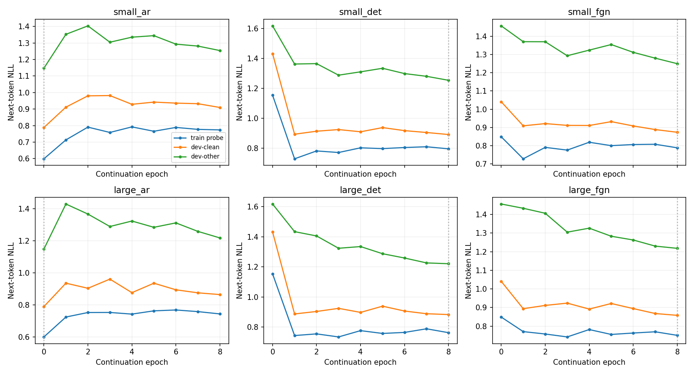
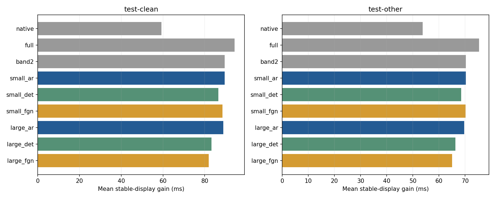
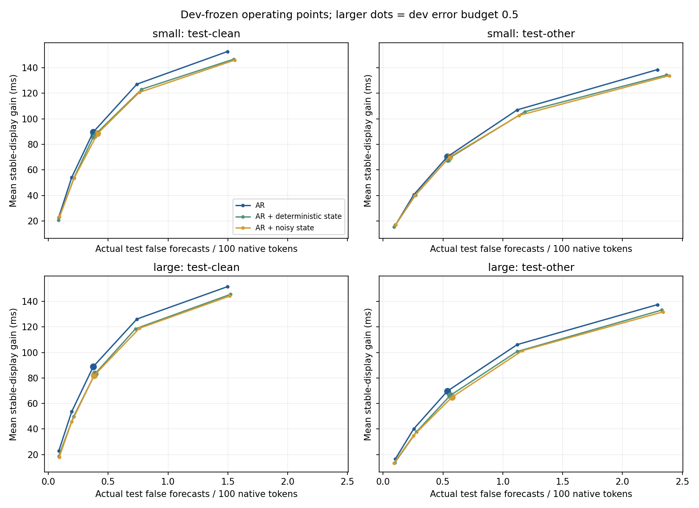

# Layer-limited AR + FGN combination experiment — 2026-11-12

**Judgment: Although the actual combined and joint learning was completed, it did not surpass the existing layer-band2 AR under this single token display condition. The basic configuration maintains the existing band2+gate. This is not an experiment that proves or disproves the general overfitting prevention effect of noise.**

The existing layer-band2 AR was retained and combined with continuous FGN acoustic-state prediction. AR token loss backpropagates into FGN and both modules are fine-tuned jointly. This differs from the preceding independent predictor.

The public 960h Zipformer is frozen. Six warm-start variants use all 28,539 train-clean-100 utterances for 8 epochs. Small AR/hybrid sizes are 4.60M/10.93M; large sizes 13.03M/19.35M. The large AR has 12 layers: four trained layers plus eight initially identity blocks.

Small stochastic hybrid display gain is 88.46/70.18ms versus same-run AR 89.63/70.30ms. Clean difference −1.17ms, CI −2.02~−0.31; other −0.12ms, CI −0.97~+0.72. Large stochastic hybrid gives 81.91/65.08ms and adds 11.87/12.23ms per chunk; small AR adds about 1.3ms. Actual test error rates differ; latency alone does not establish matched-error superiority.

The effects of Noise itself were also inconsistent. In the small combination, it was +1.93/+1.68ms ahead of the deterministic hybrid, but false forecasts increased, and in the large combination, it was −1.31/−1.21ms. Therefore, we did not observe a pattern that the display gain of noise increases when the model is expanded.

## display performance

Mean stable-display gain for **final words matching the reference**, relative to native eager display; higher is better. Final transcripts are fixed, so unchanged WER is by construction. False forecasts are counted per 100 native BPE tokens, not words.

| Configuration | clean gain ms | other gain ms | clean/other False forecast | clean/other Additional CPU ms/chunk |
|---|---:|---:|---:|---:|
| native | 59.27 | 53.74 | 0.335 / 0.507 | 0.17 / 0.07 |
| full | 94.31 | 75.31 | 0.397 / 0.583 | 1.55 / 1.50 |
| band2 | 89.58 | 70.28 | 0.375 / 0.537 | 1.43 / 1.40 |
| small_ar | 89.63 | 70.30 | 0.375 / 0.537 | 1.29 / 1.32 |
| small_det | 86.53 | 68.51 | 0.379 / 0.540 | 4.51 / 4.67 |
| small_fgn | 88.46 | 70.18 | 0.412 / 0.556 | 6.59 / 6.81 |
| large_ar | 88.89 | 69.70 | 0.375 / 0.537 | 3.70 / 3.76 |
| large_det | 83.21 | 66.29 | 0.390 / 0.561 | 8.48 / 8.71 |
| large_fgn | 81.91 | 65.08 | 0.383 / 0.577 | 11.87 / 12.23 |

## Same size internal comparison

Gates were selected under the same development error budget, but actual test errors differ. Gain differences alone do not establish matched-error Pareto superiority. Intervals use paired utterance bootstrap; speaker intervals are stored separately in the original JSON.

| split | comparison | average gain difference ms [95% CI] | false forecast difference/100 token |
|---|---|---:|---:|
| test-clean | small_det − small_ar | -3.10 [-3.97, -2.21] | +0.004 |
| test-clean | small_fgn − small_ar | -1.17 [-2.02, -0.31] | +0.036 |
| test-clean | small_fgn − small_det | +1.93 [+1.59, +2.30] | +0.032 |
| test-clean | large_det − large_ar | -5.68 [-6.53, -4.86] | +0.014 |
| test-clean | large_fgn − large_ar | -6.99 [-7.82, -6.12] | +0.008 |
| test-clean | large_fgn − large_det | -1.31 [-1.64, -0.94] | -0.007 |
| test-other | small_det − small_ar | -1.80 [-2.64, -0.96] | +0.003 |
| test-other | small_fgn − small_ar | -0.12 [-0.97, +0.72] | +0.019 |
| test-other | small_fgn − small_det | +1.68 [+1.31, +2.03] | +0.016 |
| test-other | large_det − large_ar | -3.41 [-4.27, -2.58] | +0.024 |
| test-other | large_fgn − large_ar | -4.62 [-5.49, -3.79] | +0.040 |
| test-other | large_fgn − large_det | -1.21 [-1.55, -0.86] | +0.016 |

## Model augmentation and overfitting

Noise is a function that learns the probability distribution of future acoustic features and is not a device that automatically guarantees prevention of overfitting. [FGN original text2.2.3](https://arxiv.org/html/2506.10772v1#S2.SS2.SSS3) states that some loss weights were lowered to reduce overfitting when expanding the model.

Each epoch evaluates fixed 256-example train-clean and separate 256-example model-selection probes using the same sampling/evaluation mode. Define overfitting gap as dev-clean minus train-clean NLL; dev-other confounds domain difficulty. Select checkpoints on mixed-dev NLL, allowing epoch 0.

| configure | select epoch | select dev NLL | last train NLL | last dev-clean NLL | last gap |
|---|---:|---:|---:|---:|---:|
| small_ar | 0 | 0.9751 | 0.7740 | 0.9097 | +0.1357 |
| small_det | 8 | 1.0791 | 0.7946 | 0.8904 | +0.0957 |
| small_fgn | 8 | 1.0687 | 0.7883 | 0.8734 | +0.0851 |
| large_ar | 0 | 0.9751 | 0.7428 | 0.8636 | +0.1207 |
| large_det | 8 | 1.0589 | 0.7629 | 0.8833 | +0.1205 |
| large_fgn | 8 | 1.0450 | 0.7505 | 0.8579 | +0.1074 |

These curves describe one-seed continuation. A small gap alone is not evidence of less overfitting. Inspect whether training improves while validation worsens, and whether noise improves matched-size dev NLL and actual risk–display gain. Depth and effective text context changed together.

Noise lowered the mixed dev NLL of small/large combination to 1.0791→1.0687,1.0589→1.0450, respectively. dev-clean − The train gap also became slightly smaller from 0.0957 → 0.0851,0.1205 → 0.1074. However, both learning and validation losses were improved, and there was no clear overfitting worsening pattern in the control group. It was not possible to separate the effect of probability prediction/representation learning from overfitting mitigation, and the improvement of NLL did not lead to improvement in display performance.

Generated-state standard deviation of about 0.52~0.53 confirms active noise. However, branch top tokens agree with the mixture choice on average 99.4~99.7%, with predictive mutual information about 0.0003~0.0004. Feature variation does not produce large token differences. This diagnostic alone does not establish a cause.

This NLL evaluates one fixed sampled position per utterance; do not compare directly with prior all-token/multi-horizon NLL. All four hybrids selected the last epoch, leaving longer-run convergence unresolved.

## Methods and Limitations

- The AR weight started from the existing band2, and the state weights of both hybrids started from the same state_s37. It is not the result of learning a large model from scratch.
- Shared noise, continuous state feedback and multi-level backpropagation are in the future speech features. In AR, predictive features are provided as cross-attention. This is not an experiment in which all normalization layers of AR itself are modulated with noise.
- When enlarging, only the AR was changed from 4 to 12 layer, and the FGN state generator was maintained as 6.324M. This is not an experiment that directly verifies overfitting when the FGN generator itself is expanded.
- Actual future acoustic states were used only as CRPS targets. The token prediction input contains only the arriving voice and the generated future features. We examined the FGN gradient and future input invariance of token loss.
- For actual inference, native recognition prefix is ​​used. Confirmed caches contain only observed audio; predicted features enter temporary branches only. Text KV retains 3 positions; audio KV grows with utterance length.
- The teacher-forced token NLL in the train/development table is an indicator that is different from the false-forecast rate on the actual screen.
- The preceding text state for learning is calculated by looking at the actual speech up to the selection cutoff. The actual inference stores the state at the time of past native release. In both cases, we do not add predictive speech to the pre-confirmation state, but this does not claim that the teacher forcing and streaming states are exactly the same across the varying cutoffs.
- Gate weights were fit on 1297 dev utterances and thresholds on 1414 separate utterances before evaluating 5559 test utterances. The gate, timing, and standards of the existing 3 control group were reused as is, and 12 points were accurately reproduced.
- We did not measure resource contention with the actual microphone/UI and backbone. The median display gain for each word and the actual test error rate were saved in results.json.
- It is a warm-start pilot of one seed, two depths, 8epoch, and does not prove the general scaling law or the overfitting prevention effect of FGN.
- Some independent runs were executed concurrently after checking available memory. Individual epoch times include contention, so this is not a standalone GPU speed comparison.
- The initial weights of the state were taken from a model already trained with noise. Even if the parameters are the same, the starting function and score of noise0 and probability sampling are different, and the difference in final score is not directly interpreted as an overfitting prevention effect.
- Original results were preserved; no commit/push was performed at that experiment's completion.

## file

- `experiments/band_fgn_v1/README.md`: Actual hybrid architecture, controls and reproduction sequence.
- `runs/band_fgn_v1/{variant}/{best,last}.pt`: Additional learning weights.
- `runs/band_fgn_v1/checks.json`: Causality·gradient·cache inspection.
- `experiments/band_fgn_v1/artifacts/`: Results JSON/CSV·Learning curve·Display comparison·hash.

