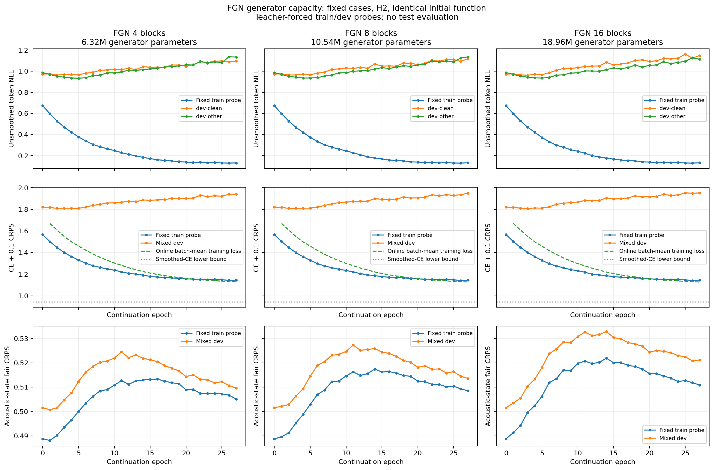

# Longer FGN training — completed

Epochs 0–11 are copied read-only evidence from the completed capacity study. Only epochs 12–27 are the requested additional training. The original best/last checkpoints remain preserved. Overfit observations do not stop this extension. The prior confirmation marker means the rule was met before extension; it is not a new stopping event.

# FGN capacity study — current status

Fixed-case fitting diagnostic; no test use. Residual correction/encoder skipping is not implemented.

| FGN blocks | Generator parameters | Epochs | Best epoch | Best dev NLL | Last train-probe NLL | Last dev NLL | Overfit confirmed |
|---|---:|---:|---:|---:|---:|---:|---|
| 4 | 6,323,968 | 27 | 5 | 0.9486 | 0.1313 | 1.1147 | Yes |
| 8 | 10,535,680 | 27 | 5 | 0.9509 | 0.1322 | 1.1269 | Yes |
| 16 | 18,959,104 | 27 | 5 | 0.9504 | 0.1319 | 1.1306 | Yes |

Matched-epoch comparison at epoch 27:

| FGN blocks | Train-probe NLL | Dev NLL | Train-probe objective | Dev objective |
|---|---:|---:|---:|---:|
| 4 | 0.1313 | 1.1147 | 1.1448 | 1.9399 |
| 8 | 0.1322 | 1.1269 | 1.1449 | 1.9491 |
| 16 | 0.1319 | 1.1306 | 1.1447 | 1.9516 |

A completed stage without the predeclared pattern is not evidence of overfitting. Online loss is the unweighted mean of training-batch objectives during each epoch; fixed-probe objectives use evaluation mode after that epoch. They differ in both examples and model state. Neither is unsmoothed token NLL.

