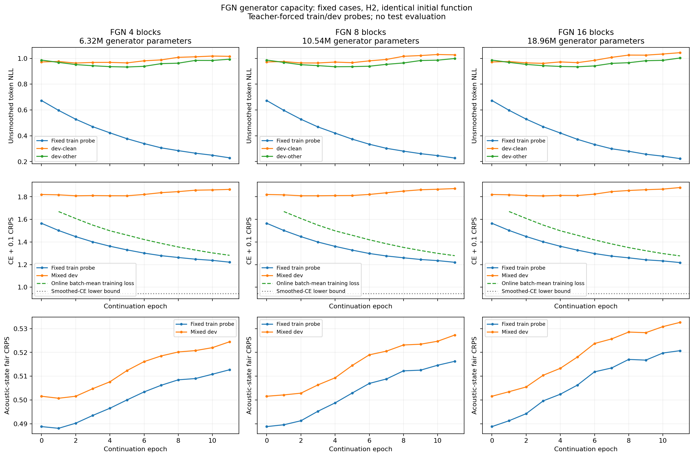

# FGN capacity study — current status

Fixed-case fitting diagnostic; no test use. Residual correction/encoder skipping is not implemented.

| FGN blocks | Generator parameters | Epochs | Best epoch | Best dev NLL | Last train-probe NLL | Last dev NLL | Overfit confirmed |
|---|---:|---:|---:|---:|---:|---:|---|
| 4 | 6,323,968 | 11 | 5 | 0.9486 | 0.2288 | 1.0042 | Yes |
| 8 | 10,535,680 | 11 | 5 | 0.9509 | 0.2269 | 1.0127 | Yes |
| 16 | 18,959,104 | 11 | 5 | 0.9504 | 0.2228 | 1.0228 | Yes |

Matched-epoch comparison at epoch 11:

| FGN blocks | Train-probe NLL | Dev NLL | Train-probe objective | Dev objective |
|---|---:|---:|---:|---:|
| 4 | 0.2288 | 1.0042 | 1.2214 | 1.8652 |
| 8 | 0.2269 | 1.0127 | 1.2203 | 1.8725 |
| 16 | 0.2228 | 1.0228 | 1.2179 | 1.8817 |

A completed stage without the predeclared pattern is not evidence of overfitting. Online loss is the unweighted mean of training-batch objectives during each epoch; fixed-probe objectives use evaluation mode after that epoch. They differ in both examples and model state. Neither is unsmoothed token NLL.

