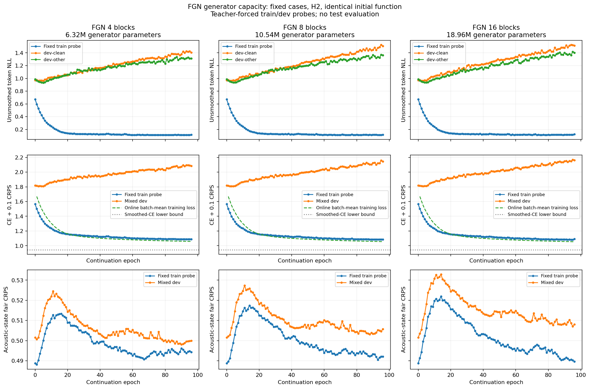

# Epoch-wise double-descent investigation

Status: completed. Epochs 0–27 are inherited; only epochs 28–96 are newly trained here. No overfit-based stopping. Three warm-started depths and one seed do not establish a model-wise double-descent curve.

# FGN capacity study — current status

Fixed-case fitting diagnostic; no test use. Residual correction/encoder skipping is not implemented.

| FGN blocks | Generator parameters | Epochs | Best epoch | Best dev NLL | Last train-probe NLL | Last dev NLL | Overfit confirmed |
|---|---:|---:|---:|---:|---:|---:|---|
| 4 | 6,323,968 | 96 | 5 | 0.9486 | 0.1178 | 1.3571 | Yes |
| 8 | 10,535,680 | 96 | 5 | 0.9509 | 0.1164 | 1.4322 | Yes |
| 16 | 18,959,104 | 96 | 5 | 0.9504 | 0.1272 | 1.4575 | Yes |

Matched-epoch comparison at epoch 96:

| FGN blocks | Train-probe NLL | Dev NLL | Train-probe objective | Dev objective |
|---|---:|---:|---:|---:|
| 4 | 0.1178 | 1.3571 | 1.0896 | 2.0836 |
| 8 | 0.1164 | 1.4322 | 1.0852 | 2.1471 |
| 16 | 0.1272 | 1.4575 | 1.0913 | 2.1618 |

A completed stage without the predeclared pattern is not evidence of overfitting. Online loss is the unweighted mean of training-batch objectives during each epoch; fixed-probe objectives use evaluation mode after that epoch. They differ in both examples and model state. Neither is unsmoothed token NLL.

