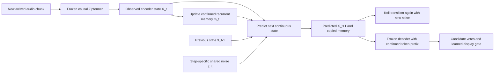

# Continuous-state FGN pilot

This is a new, isolated FGN-inspired ASR experiment. It does not overwrite the
earlier full-context/band2 forecasters or change the frozen acoustic backbone.

## Hypothesis and adaptation

The earlier short-context token predictor did not implement the full state
transition idea. Here a 6.324M-parameter forecaster maintains a learned recurrent
256-dimensional summary of arrived audio. A state contains eight 512-dimensional
encoder frames (320ms); two recent states and that summary are the transition
inputs. The model generates an entire continuous next state and updates its
summary using that prediction. Later losses backpropagate through those predicted
states and memories without discrete argmax or detach in the state feedback.

Independent 32-dimensional Gaussian noise is drawn at each future step. Within a
step the same noise embedding conditions every frame position and conditional
normalization layer. It is NOT a single noise draw held fixed across all future
steps. Two independently trained models additionally form a model ensemble.

The source of the design is the [FGN paper](https://arxiv.org/abs/2506.10772),
particularly Sections 2.1–2.4. This adaptation predicts ASR encoder states rather
than weather, uses an 8-position attention transition instead of the original
spatial GNN, and adds a frozen-RNN-T task loss. It is not an original-FGN
reproduction. Text is not input to the state transition. The frozen decoder uses
the confirmed text prefix when speculative continuous states are decoded.

Future target states enter the training losses only. Confirmed memory updates
from arrived observations; speculative memories never overwrite it. The matched
display experiment still shows at most one provisional token. Separate path-hit
and joint-energy diagnostics evaluate the generated multi-step trajectories.

## Controlled setup

- Frozen public 66.11M streaming Zipformer, LibriSpeech960h pretrained, BPE500,
  320ms chunks. Final native output is unchanged.
- New forecaster training: train-clean-100 only. Train-only state normalization.
- Five 16-epoch variants: full state model seeds37/38, reset-to-last-two memory,
  deterministic noise-zero control, and one-step-only training control. Seed37
  weights/sample orders/cutoff choices start matched; architecture is identical.
  Reset removes only the new forecaster's older recurrent-memory path. The
  frozen Zipformer encoder still has its own causal cache, so even recent
  encoder states already contain some older acoustic information.
- A sixth16-epoch model, `crps_only_s37`, tests the original marginals-only
  training principle. It has the same initialization/data/order/rollout schedule
  but token-loss weight0. Its checkpoint is selected by H4 CRPS only; the other
  models use CRPS+0.1token NLL. This checkpoint-criterion difference is explicit.
  A label-perturbation check proves future token targets/contexts cannot change
  this model's loss or gradient. The frozen representation is still ASR-pretrained.
- Both full-state seeds are evaluated individually as well as in an ensemble;
  the primary single model is seed37 rather than whichever seed wins on test.
- Fair CRPS on continuous state ensembles plus 0.1 times native-token distillation
  NLL through the frozen decoder/joiner. Blank frame weight0.2. This is not a
  reference-transcript WER optimization objective.
  CRPS-only is the exception. This comparison separates the ASR-specific task
  guidance from joint structure learned with only marginal forecast supervision.
- Rollout schedule: epochs1–4 H1,5–8 H2,9–12 H4,13–16 H8. One-step control H1
  throughout. Validation is fixed H4 on256 model-selection utterances. Checkpoint
  selection may choose an earlier training phase; selected epoch is reported.
- Existing speaker-disjoint gate-fit and gate-calibration cohorts; no test gate
  fitting or threshold search. Calibrate at0.5 false introduced forecasts per100
  native final tokens; actual test risk is reported separately.
- Five risk-curve operating points (dev budgets0.1/0.25/0.5/1/2) are frozen
  before test collection; no best test threshold is selected afterwards.
- One provisional token is displayed for the matched replay comparison. Eight
  trajectories and two future states provide candidate votes; empty paths count
  as abstentions and may be the mode. The deterministic model has one identical
  path rather than eight duplicate computations.
- Every new gate has the same11 inputs: eight vote/prefix features and three
  decoder-probability confidence features. The latter are the mean first-emission
  top-two logit-probabilities and entropy for members agreeing on the candidate,
  using the native decoder's temperature2. They make a one-path deterministic
  control informative despite its necessarily unanimous vote. Existing control
  gates stay frozen at their original8/9 features; raw vote-only scores should not
  be interpreted as a fair confidence comparison with the deterministic model.
- Four-state/16-member diagnostics separately test multi-token path hits and joint
  coherence against frame-wise member shuffling that preserves marginals.
- A no-training persistence baseline repeats the latest arrived encoder chunk
  as the future state and decodes with the updated confirmed prefix. It audits
  whether replay of observed acoustics suffices without a learned forecaster.

## Fair interpretation

This pilot tests whether persistent continuous memory, differentiable rollout
and shared functional noise help beyond the earlier one-token forecast. Each
ingredient needs its own ablation. Ensemble gains are separated from a single
model. Matching final WER is by construction and is not an accuracy improvement.
Display gains must be read with actual false-forecast rates and computation.
The new ablations match optimizer steps, not FLOPs: longer rollouts cost more.
Future native prefixes condition the frozen decoder critic during training loss
computation only; they are not state-transition inputs. Discrete decoding at
inference feeds its own predicted tokens back into the frozen decoder.

Timing uses simulated native chunk arrival plus measured extra CPU work, not
an actual microphone/UI test. Stable-word display is not irreversible commit
latency. Tensor-state counts exclude backbone, weights, allocator, temporary
activations and the offline feature cache. A fixed-size learned memory is lossy;
it can retain old information but does not guarantee perfect whole-history recall.

## Files and execution

| File | Role |
|---|---|
| config.json | Frozen experiment definition and training schedule |
| prepare.py | Read existing encoder caches; export differentiable frozen bridge |
| data.py | Train/validation sampling and immutable packed cache access |
| model.py | Recurrent state transition, shared noise, rollout losses |
| check.py | Future-leakage, gradient and original-decoder equivalence checks |
| train.py / run_training.py | Sequential local MPS training and budget control |
| config_crps_only.json / train_crps_only.py / run_crps_only.py | Isolated marginal-only control after the original queue |
| check_crps_only.py | Exact loss/gradient invariance to future token supervision |
| runtime.py / check_runtime.py | Confirmed memory, independent forecast branches, bounded-state checks |
| collect.py | CPU causal forecast collection with frozen old controls |
| analyze.py | Dev-only gates, calibrated thresholds, paired stable-display replay |
| diagnose.py | Joint-state and multi-token-trajectory diagnostics |
| ../../runs/fgn_state_v1 | Logs, checkpoints, provenance, gates and results |
| artifacts/ | Small reviewable result tables, figures and provenance; no weights or audio features |

Use `.local/venv-fgn-state/bin/python`. Train with
`experiments/fgn_state_v1/run_training.py`; after every variant finishes, collect
dev, calibrate, collect test, and evaluate in that order. Collection provenance
rejects mixed checkpoints/source revisions. The wall budget is recorded in
`runs/fgn_state_v1/budget.json`; it is a six-hour ceiling, not a requirement to
consume idle time.

The recorded run uses both `run_training.py` and `run_crps_only.py` before
`run_evaluation.py`. The wall-budget JSON stores this run's absolute times;
refresh it for a separate run rather than reusing an expired clock. Direct
`train.py`/`train_crps_only.py` calls without `--deadline` do not impose that clock.
Preserve the existing results when starting a separate experiment.

Completed figures: [learning curves](artifacts/learning_curves.png),
[baseline comparison and error rates](artifacts/display_gain_and_risk.png),
[dev-frozen risk/gain operating points](artifacts/risk_gain_curves.png).
The combined validation curve always plots CRPS+0.1token NLL for comparison,
including the CRPS-only model; that model is trained/selected with CRPS only.
